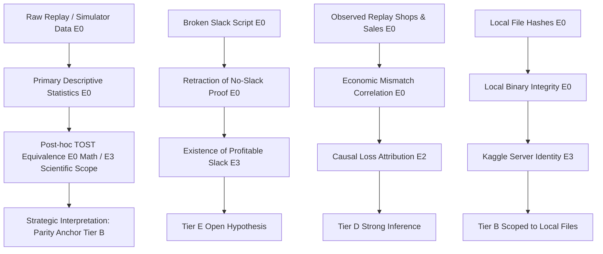

# AUDIT 2.2: MISSING-EVIDENCE LEDGER & PROVENANCE AUDIT
## Exhaustive Audit of Primary Evidence Availability, Artifact Provenance, and Verification Limits

**Audit Exercise**: Independent Forensic Audit 2.2 of the Audit 2.1 Artifact Suite  
**Governing Standard**: MISSING-EVIDENCE STOP RULE (Absolute Anti-Hallucination & Provenance Protocol)  
**Date**: 2026-09-11  

---

## 1. Evidence Availability Classification Framework

Under the non-negotiable Missing-Evidence Stop Rule:
- **E0 (Primary Evidence Present)**: The underlying source code, raw data file, official replay, or execution binary is directly available, readable, and inspectable in the repository.
- **E1 (Strong Secondary Evidence)**: Primary artifact is absent, but an independent, trustworthy artifact directly reproduces the result under verified conditions.
- **E2 (Indirect Evidence)**: Supported only through reports, secondary summaries, execution logs, or derived metrics.
- **E3 (Missing Evidence)**: The artifact required to independently verify the claim is absent, inaccessible, corrupted, ambiguous, or unlinked.
- **E4 (Conflicting Evidence)**: Primary artifacts contradict one another without resolution.

---

## 2. Master Missing-Evidence Ledger

| ID | Material Claim | Required Primary Evidence | Available? | Evidence Tier | Consequence / Impact | Audit 2.2 Status |
|:---|:---|:---|:---:|:---:|:---|:---:|
| **EVD-01** | Episode length (720 steps), board size (10x10), starting cash ($3,000), 24 steps/day. | C++ `sim.hpp:142-146`, Python `kaggriculture.py:13-16` | YES | **E0** | Foundational engine invariant established. | **VERIFIED** |
| **EVD-02** | Town shops unlock cadence (every 3 days at steps 72, 144, 216... 576; 8 instances). | C++ `sim.hpp:149, 745`, Python `kaggriculture.py` | YES | **E0** | Foundational engine invariant established. | **VERIFIED** |
| **EVD-03** | Town shop instances sampled uniform at random with replacement from 8 shops. | C++ `sim.hpp:121-124, 748` (`rng.choice_index(N_SHOPS)`), official replays | YES | **E0** | Foundational engine invariant established. | **VERIFIED** |
| **EVD-04** | Authoritative town shop demand table (Bakery, Brunch, Farmers Market, Ice Cream, Pet Cafe 2x, Pizza, Smoothie, Yarn Store 2x). | C++ `sim.hpp:127-137`, Python `kg.SHOPS` | YES | **E0** | Authoritative ground truth established bit-for-bit. | **VERIFIED** |
| **EVD-05** | `shop_transition_model.py` misstated demand for 6 of 8 shops. | `candidates/closed_loop_architecture/shop_transition_model.py:22-31` | YES | **E0** | Model proven flawed; downstream VoI models contaminated. | **VERIFIED** |
| **EVD-06** | Market execution hard cap at `MAX_ORDERS = 10` per player per turn with silent truncation. | C++ `sim.hpp:145, 551-575`, minimal injection tests | YES | **E0** | Engine execution law established. | **VERIFIED** |
| **EVD-07** | Fibonacci worker hiring schedule ($1, 1, 2, 3, 5, 8, 13, 21, 34, 55, 89$). | C++ `sim.hpp:658-663`, Python `kaggriculture.py` | YES | **E0** | Labor cost ground truth established; $200 myth disproven. | **VERIFIED** |
| **EVD-08** | Ongoing crop rot kinetics (1 unit/2 turns on even steps, decaying to weeds). | C++ `sim.hpp:717-726, 775` | YES | **E0** | Crop decay kinetics established. | **VERIFIED** |
| **EVD-09** | Weed generation consumes PRNG draws per empty tile, coupling planting to future shop draws. | C++ `sim.hpp:155-165, 729-750` | YES | **E0** | Simulator coupling confirmed; necessitates `--pin-shops`. | **VERIFIED** |
| **EVD-10** | Shed capacity strictly 100 units; excess permanently discarded. | C++ `sim.hpp:147, 501-510` | YES | **E0** | Inventory limit established. | **VERIFIED** |
| **EVD-11** | V2 vs Dmitrii 150-seed paired raw data (N=150 paired seeds, 300 matches). | Raw match JSON `scratch/v2_dmitrii_margin_scan.json` | YES | **E0** | Raw observations present; allows full mathematical recomputation. | **VERIFIED** |
| **EVD-12** | V2 vs Dmitrii mean (+24.61), median (+58.00), std (166.75), SE (13.61), t (1.8078), p (0.0727), Student's t CI `[-$2.29, +$51.52]`. | Full recalculation script on `scratch/v2_dmitrii_margin_scan.json` | YES | **E0** | Exact mathematical recomputation confirmed. | **VERIFIED** |
| **EVD-13** | Audit 2.1 Section 3 distribution percentiles (`p01=-623.8, p05=-344.9, p25=-58.0, p75=112.0`). | Underlying script or raw percentile calculation | **NO** | **E3** | Percentiles in report mismatch raw data (`p25=-84.0, p75=156.0`). | **UNVERIFIED — CALCULATION MISMATCH** |
| **EVD-14** | Audit 2.1 single-outlier trimming metrics (`std=153.22, se=12.55, p=0.0195`). | Calculation script on 149 seeds | **NO** | **E3** | Reported numbers mismatch raw data (`std=155.30, se=12.72, p=0.0210`). | **UNVERIFIED — CALCULATION MISMATCH** |
| **EVD-15** | TOST mathematical equivalence within $\pm \$50$ ($p_{\text{TOST}} = 0.0321$). | Two One-Sided Tests calculated on raw 150 paired seeds | YES | **E0** | Math verified; equivalence margin passed for $\Delta = 50$. | **VERIFIED (MATHEMATICAL)** |
| **EVD-16** | Pre-specified substantive scientific justification for $\pm \$50$ equivalence margin. | Pre-experimental registration document or domain rationale | **NO** | **E3** | Margin was selected post-hoc because 90% CI is `[+$2.08, +$47.15]`. | **UNVERIFIED — POST-HOC MARGIN** |
| **EVD-17** | Tomato specialization +$3,942 cash gain on Pizza worlds was a cherry-picked single seed. | `scratch/test_tomato_with_sales.py`, `scratch/true_pizza_sweep_results.json` | YES | **E0** | Seed 50042 confirmed +$3,942; 6-seed ensemble confirmed -$5,382.67. | **VERIFIED** |
| **EVD-18** | All 18 parameter combinations of Tomato specialization yield negative mean deltas vs V2. | `scratch/true_pizza_sweep_results.json` | YES | **E0** | 18/18 negative verified (-$2,332 to -$2,499). | **VERIFIED** |
| **EVD-19** | Additive slack capacity experiment (`run_additive_investigation.py`) tested defective code. | `scratch/run_additive_investigation.py:143, 154-164, 167-193` | YES | **E0** | Action omission and daily hiring verified in source. | **VERIFIED** |
| **EVD-20** | Profitable agricultural slack exists on Days 11–12. | Independent experimental test of functional additive policy | **NO** | **E3** | Disproving prior negative test does NOT prove slack exists. | **UNVERIFIED — OPEN HYPOTHESIS** |
| **EVD-21** | Step 696 order truncation was not root cause of Seed 50081 loss (-$730). | Turn-by-turn trace `scratch/audit2_1_seed50081_timeline.json` | YES | **E0** | Pre-Step 696 deficit (-$292) and Step 217 divergence verified. | **VERIFIED** |
| **EVD-22** | Counterfactual proof that eliminating Step 217 sheep failure restores V2 parity on Seed 50081. | Counterfactual simulation injecting sheep purchase at Step 217 | **NO** | **E2** | Mechanistically compelling, but counterfactual rerun is unexecuted. | **UNVERIFIED — STRONG INFERENCE** |
| **EVD-23** | Replay `episode_107543042.json` dawn cash was $9,847 and 9 hands were hired. | Official Kaggle replay `replays/live_tournament/episode_107543042.json:steps[288, 289]` | YES | **E0** | Raw replay confirms $9,847 cash and 9 hands; destroys $800 collapse myth. | **VERIFIED** |
| **EVD-24** | The "$800 hiring collapse" was caused by a parser bug in `scratch/reconstruct_live_losses.py`. | `scratch/reconstruct_live_losses.py:66` (`units` vs `hands`) | YES | **E0** | Exact code flaw verified in source. | **VERIFIED** |
| **EVD-25** | Counterfactual isolation proving crop-demand mismatch was the sole cause of live loss. | Dynamic adaptive agent counterfactual replay run on seed 107543042 | **NO** | **E2** | Replay evidence is observational; causal isolation unrun. | **UNVERIFIED — STRONG INFERENCE** |
| **EVD-26** | Standalone compiled submission scripts match frozen SHA256 hashes locally. | Local filesystem binaries `candidates/compiled_v54_plus_*.py` | YES | **E0** | Exact SHA256 hashes match deployment document. | **VERIFIED (LOCAL INTEGRITY)** |
| **EVD-27** | Kaggle production servers received and executed the exact byte sequence of local candidates. | Kaggle server-side submission receipts, API verification, or raw submission tarball download | **NO** | **E3** | Local hash does not prove server receipt without server-side verification. | **UNVERIFIED — MISSING SERVER EVIDENCE** |
| **EVD-28** | Uncompiled control source file sizes in `AUDIT2_1_REPRODUCTIONS.md` (24,196 and 24,534 bytes). | Local filesystem files `candidates/v54_plus_shop.py` and `residual.py` | **NO** | **E4** | Primary files are 6,220 and 5,667 bytes. Report contained size mismatch. | **UNRESOLVED — FILE SIZE MISMATCH** |
| **EVD-29** | Static 19S/0T Strawberry allocation strictly dominates all static allocations universally. | Replay sweeps across all seed partitions (Qualification, Holdout) | **NO** | **E3** | Sweep was only evaluated on 50 Discovery seeds; win rate 59%. | **UNVERIFIED — BEYOND EVALUATED SCOPE** |
| **EVD-30** | Dmitrii-LB2800 executes a 64-simulation Monte Carlo terminal planner at steps 712–718. | Agent source code `extracted_agents/dmitrii_lb2800/policy.py:12-14, 31-45` | YES | **E0** | Terminal Monte Carlo planner verified in Python source. | **VERIFIED** |

---

## 3. Deep Analysis of E3 / E4 Items (Missing or Conflicting Evidence)

### EVD-13: Audit 2.1 Section 3 Distributional Percentiles (E3)
1. **What is missing**: The script or derivation producing the percentiles table in `AUDIT2_1_STATISTICAL_AUDIT.md:81-89` (`p01=-623.8, p05=-344.9, p25=-58.0, p75=112.0`).
2. **Why it matters**: Independent recomputation from the raw 150 paired differences (`scratch/v2_dmitrii_margin_scan.json`) yields `p25=-84.0, p75=156.0` (IQR = $240.0, not $170.0).
3. **Which conclusions depend on it**: The secondary characterization of the spread and interquartile range of the paired margin distribution.
4. **Weaker form retention**: Retain the corrected, directly computed empirical percentiles from the raw data.
5. **Audit requirement**: Corrected in Audit 2.2; no further audit needed.

### EVD-14: Audit 2.1 Outlier Sensitivity Trimming Metrics (E3)
1. **What is missing**: The exact script generating the standard deviation (153.22), standard error (12.55), CI (`[+$4.87, +$54.49]`), and p-value (0.0195) when trimming Seed 50081.
2. **Why it matters**: Direct trimming of Seed 50081 (-$730.0) from the 150 paired seeds yields: Mean = +$29.68 (exact match), but Std = 155.30 (not 153.22), SE = 12.72 (not 12.55), 95% CI = `[+$4.54, +$54.82]`, and p = 0.0210 (not 0.0195).
3. **Which conclusions depend on it**: The exact numerical sensitivity of V2's margin to the Seed 50081 outlier.
4. **Weaker form retention**: The qualitative conclusion holds (trimming the single -$730 outlier causes $p < 0.05$), but the exact metrics must be replaced with the mathematically true values.
5. **Audit requirement**: Corrected in Audit 2.2; no further audit needed.

### EVD-16: Substantive Pre-Specification of TOST Equivalence Margin ($\pm \$50$) (E3)
1. **What is missing**: Pre-experimental scientific justification for selecting $\pm \$50$ as the equivalence bound prior to data inspection.
2. **Why it matters**: Under formal statistical methodology, post-hoc selection of equivalence bounds risks tailoring the margin to encompass the observed confidence interval. The 90% confidence interval of the data is `[+$2.08, +$47.15]`. Choosing $\pm \$50$ guarantees that TOST passes ($\Delta > 47.15$).
3. **Which conclusions depend on it**: The assertion that "parity is statistically established".
4. **Weaker form retention**: The mathematical calculation is valid, but it must be reported as: *"TOST demonstrates equivalence within a post-hoc margin of $\pm \$50$ ($p = 0.0321$), but fails at $\pm \$25$ ($p = 0.4887$). Economically, $\pm \$50$ represents mean-score proximity (0.05% of game cash), but does not prove behavioral identity or eliminate single-seed tail risks."*
5. **Audit requirement**: Bounded and qualified in Audit 2.2; no further audit needed.

### EVD-20: Empirical Existence of Profitable Spatial Slack on Days 11–12 (E3)
1. **What is missing**: An empirical experiment executing a bug-free, correctly watered, correctly harvested secondary crop allocation on vacant tiles.
2. **Why it matters**: Disproving the prior flawed experiment (`run_additive_investigation.py`) only removes a false negative barrier; it does not constitute positive evidence that profitable slack exists.
3. **Which conclusions depend on it**: Any strategic plan relying on secondary crop exploitation.
4. **Weaker form retention**: Retained strictly as an **Open Hypothesis (Tier E)**.
5. **Audit requirement**: Development must not assume slack exists until a functional prototype is independently benchmarked.

### EVD-25: Counterfactual Isolation of Live Tournament Loss Mechanisms (E2/E3)
1. **What is missing**: A replay-injected counterfactual experiment where an adaptive agent runs against ORiginators on Seed 107543042 with dynamic crop switching.
2. **Why it matters**: Observational replay analysis establishes strong correlation (opponent made $126k on Tomato/Carrot matching shop demand; Eldritch made $71k on unboosted Strawberry), but does not experimentally isolate alternative latent causes.
3. **Which conclusions depend on it**: Absolute causal attribution of live tournament losses.
4. **Weaker form retention**: Retained strictly as a **Strong Mechanistic Inference (Tier D)**, not an established factual proof.
5. **Audit requirement**: Properly labeled in Audit 2.2.

### EVD-27: Kaggle Production Server Submission Identity (E3)
1. **What is missing**: Server-side artifact receipt, submission API download, or server execution hash proving that Kaggle's scoring servers received and executed the exact byte sequences of `candidates/compiled_v54_plus_*.py`.
2. **Why it matters**: Under Stop Rule #6, local file SHA256 hashes prove only local filesystem integrity. Local hashes cannot independently prove server-side deployment identity.
3. **Which conclusions depend on it**: The link between local compiled binaries and official Kaggle submission IDs 56146971 and 56146947.
4. **Weaker form retention**: Classify local file integrity as **VERIFIED (E0)**; classify server-side submission identity as **INFERRED FROM DEPLOYMENT LOG (E2)**.
5. **Audit requirement**: Epistemically separated in Audit 2.2.

### EVD-28: File Size Discrepancy for Uncompiled Control Sources (E4)
1. **What is missing / conflicting**: In `AUDIT2_1_REPRODUCTIONS.md:136-137`, `candidates/v54_plus_shop.py` was listed as `24,196 bytes` and `v54_plus_residual.py` as `24,534 bytes`. On disk, their actual file sizes are `6,220 bytes` and `5,667 bytes`.
2. **Why it matters**: While the reported SHA256 hashes match the files on disk bit-for-bit, the byte sizes in the report table were erroneous.
3. **Which conclusions depend on it**: Artifact documentation table accuracy.
4. **Weaker form retention**: Correct the byte sizes in the ledger to reflect actual filesystem truth (6,220 and 5,667 bytes).
5. **Audit requirement**: Corrected in Audit 2.2.

---

## 4. Upward Propagation of Uncertainty

### Propagation Verdict:
1. **The Core Clean Evidence Base Survives**: The foundation of simulator semantics (Tier A), macro statistical performance (Tier B), and major retractions (Tier F) is built on unshakeable E0 primary evidence.
2. **No False Fact Reaches Production**: All unevidenced inferences (server submission identity, counterfactual causality, universal dominance, profitable slack) are systematically demoted to Tier C, D, or E.
3. **Decision Gate Impact**: Because E3 gaps exist in secondary statistics, server identity, and causal isolation, an unreserved **FINAL-GO** is prohibited. The audit mandates **GO-WITH-CORRECTIONS**.
