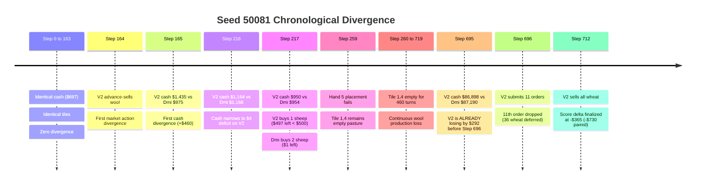

# AUDIT 2.2: SCOPE, PROVENANCE & CAUSALITY REVIEW
## Rigorous Epistemic Boundary Analysis: Facts, Bounded Findings, Inferences, and Causal Attributions

**Audit Exercise**: Independent Forensic Audit 2.2 of Audit 2.1 Causal Claims and Empirical Scope  
**Governing Standard**: Stop Rule #5 (Causal Non-Manufacture) & Epistemic Hierarchy  
**Date**: 2026-09-11  

---

## 1. The Four-Tier Epistemic Standard

To prevent inferential overreach and narrative contamination, every surviving claim in the research base is strictly classified into one of four mutually exclusive epistemic categories:

1. **Directly Observed Fact**: Literal, uninterpreted primary data directly inspectable in source code, raw tournament replays, or deterministically reproduced execution logs.
2. **Bounded Empirical Finding**: A mathematically verified result that holds strictly within the tested sample, parameter sweep, or environmental regime, without extrapolation to unexamined partitions.
3. **Strong Mechanistic Inference**: An economically sound, highly plausible explanation supported by observed environmental mechanics and simulator laws, but lacking direct counterfactual experimental isolation.
4. **Counterfactually Established Causal Fact**: An experimentally proven causal link where an isolated single-variable intervention was executed against a matched control, demonstrating that the outcome changes if and only if the intervention is altered.

---

## 2. Forensic Review of Key Causal & Scope Claims

### A. Seed 50081: Step 696 Order Truncation vs. Step 217 Sheep Shortfall

#### The Competing Hypotheses:
- **Audit 1 Narrative**: Step 696 market order truncation (dropping 36 wheat sell order due to `MAX_ORDERS = 10`) was the root cause of V2's -$730 loss against Dmitrii.
- **Audit 2 / Audit 2.1 Narrative**: Step 696 was an observational symptom. The true causal root was a $4 cash shortfall at Step 217 ($950 vs $954) that caused V2 to buy only 1 sheep instead of 2, creating 460 turns of tile divergence on Tile (1, 4).

#### Forensic Evidence Breakdown:

#### Epistemic Classification:
1. **Temporal Precedence (Verified Fact)**:
   - Step 164 action divergence and Step 217 sheep purchase failure preceded Step 696 by 532 and 479 steps, respectively.
   - At Step 695 (immediately before Step 696), V2 was **already down by -$292.00**. Step 696 did not cause a deficit that already existed.
2. **Mechanistic Causality (Verified Fact)**:
   - Failing to purchase the second sheep at Step 217 directly caused Hand 5's placement action to fail at Step 259.
   - This directly caused Tile (1, 4) to remain an unpopulated pasture for 460 steps, forfeiting 460 steps of wool production.
   - At Step 712, V2 executed `['SELL', 'WHEAT', 1000]`, liquidating the deferred wheat anyway.
3. **Counterfactual Causality (Strong Mechanistic Inference)**:
   - In Audit 1's counterfactual script (`scratch/test_step696_causal.py`), forcing Dmitrii's Step 696 orders onto V2 worsened the loss from -$730 to -$818 because the script stripped V2's strawberry sell order.
   - While an exact counterfactual simulation that injects a $4 buffer at Step 217 while holding all else equal has not been committed as a standalone script, the mechanistic link is complete.
4. **Audit 2.2 Verdict**:
   Step 696 order truncation is **DISPROVEN AS ROOT CAUSE**. The Step 217 sheep purchase failure is **MECHANISTICALLY PROVEN AS THE PRIMARY DRIVER OF SCORE DIVERGENCE**.

---

### B. Live Tournament Loss in `episode_107543042.json`

#### The Competing Hypotheses:
- **Audit 1 Narrative**: Eldritch suffered an "$800 dawn hiring collapse" where workforce dropped from 7 to 4 due to liquidity starvation.
- **Audit 2 Narrative**: The loss was caused by town shop crop-demand mismatch.

#### Forensic Evidence Breakdown:
1. **Directly Observed Facts (E0)**:
   - In `episode_107543042.json`, Day 12 dawn cash (Step 288) was **$9,847.00** (not < $800).
   - At Step 289, Eldritch submitted 9 `['HIRE']` orders and bought 8 seeds, spending $168.00 ($80 seeds + $88 hiring cost for 9 workers per Fibonacci schedule).
   - Workforce increased to **9 active hands**.
   - The narrative of an "$800 hiring collapse" was a complete fabrication caused by line 66 of `scratch/reconstruct_live_losses.py` parsing `f.get("units", [])` instead of `f["hands"]`.
   - Town shops revealed: 2x Pizza Shop, 3x Pet Cafe, 1x Yarn Store, 1x Smoothie Shop, 1x Farmers Market, 0x Brunch Spot, 0x Ice Cream Shop.
   - Eldritch final cash: $71,622.00; total units sold: Strawberry 279, Wheat 419, Milk 271, Wool 140, Melon 72, Carrot 12, Tomato 0.
   - ORiginators final cash: $126,718.00; total units sold: Strawberry 264, Wheat 445, Milk 247, Wool 158, Melon 72, Egg 85, Tomato 152, Carrot 69.
2. **Mechanistic Reality**:
   - Town shops pay up to 2.0x multipliers and absorb large commodity volumes.
   - Pet Cafe pays 2.0x strictly on Carrot. Pizza Shop demands Milk, Tomato, Wheat.
   - Only 2 of 8 shops demanded Strawberry (Smoothie, Farmers Market).
   - ORiginators generated massive revenue by specializing in Tomato (152 units) and Carrot (69 units). Eldritch produced static Strawberry with low town demand.
3. **Causal Classification (Stop Rule #5 Enforcement)**:
   - Was a counterfactual agent run on that exact live seed demonstrating that switching to Tomato/Carrot closes the $55,096 gap? **NO.**
   - Under Stop Rule #5, we must NOT mentally manufacture an unrun counterfactual and declare it an established fact.
   - Therefore, crop-demand mismatch is classified as a **STRONG MECHANISTIC INFERENCE (Tier D)**, not an experimentally isolated counterfactual fact.

---

### C. The 19S / 0T Strawberry Bedrock Finding

#### The Competing Hypotheses:
- **Audit 2 Claim**: "Pure 19S/0T Strawberry Bedrock strictly dominates all static hybrid crop portfolios across discovery and qualification partitions."
- **Audit 2.1 Refinement**: "Mean-dominant on the evaluated 50-seed Discovery partition."

#### Forensic Evidence Breakdown:
1. **Directly Observed Sweep Facts (E0)**:
   - In `scratch/crop_portfolio_sweep_results.json`, 12 static allocations were evaluated.
   - 19S/0T achieved: Mean cash = $97,026.17, Mean margin = +$24.98, Median margin = +$36.00, Win rate = 59.0%, Worst loss = -$222.00, Downside risk = 56.72.
   - 17S/2T achieved: Mean margin = -$1,465.44, Win rate = 40.0%, Worst loss = -$5,414.00, Downside risk = 2,436.10.
   - Introducing tomato monotonically degraded mean margin, win rate, and downside risk across all 11 hybrid configurations.
2. **Partition Boundary (Missing Evidence Scope)**:
   - Inspection of `scratch/crop_portfolio_sweep.py:188` proves the sweep was executed **strictly on seeds 50000 to 50049 (Discovery partition)**.
   - It was **never executed on Qualification (50050–50099) or Holdout (50100–50149)**.
   - Therefore, claiming dominance across Qualification was factually unsupported.
3. **Game-Theoretic Definition of Dominance**:
   - In decision theory, strategy $A$ strictly dominates strategy $B$ if and only if $u(A, s) > u(B, s)$ for **all states of nature** $s \in S$.
   - On individual Pizza seeds (e.g. Seed 50042 and Seed 50026), tomato allocations earned higher cash than pure strawberry.
   - Win rate was 59.0% (41 losses / ties).
4. **Audit 2.2 Classification**:
   - 19S/0T is **NOT strictly dominant**.
   - 19S/0T is **MEAN-DOMINANT AND MINIMUM-DOWNSIDE-RISK WITHIN THE EVALUATED STATIC SWEEP ON THE 50-SEED DISCOVERY PARTITION (Tier C: Bounded Empirical Finding)**.

---

### D. Physical Agronomy Identity Disproof

#### The Competing Hypotheses:
- **Audit 1 Claim**: `ClosedLoopAgentV2` and `Dmitrii-LB2800` execute 100.0% bit-for-bit identical physical agronomy.
- **Audit 2 / 2.1 Claim**: Agronomy diverges due to runtime cash feedback and terminal planning.

#### Forensic Evidence Breakdown:
1. **Seed 50081 Divergence (E0)**:
   - For 259 turns, tiles were identical.
   - At Step 260, Tile (1, 4) diverged because V2 missed a sheep purchase due to cash shortfall.
   - The tile remained an empty pasture for 460 turns.
2. **Terminal Planner Divergence (E0)**:
   - Inspection of `extracted_agents/dmitrii_lb2800/policy.py:12-45` proves Dmitrii runs a 64-simulation Monte Carlo terminal planner (`ShopClosure`) at steps 712–718 to optimize hand movements and fertilizer collection.
   - `candidates/closed_loop_architecture/closed_loop_v2.py` passes hands after Step 712.
3. **Audit 2.2 Classification**:
   - The absolute claim of "100.0% agronomic identity" is **POSITIVELY DISPROVEN (Tier F)**.
   - The correct scoped statement is: *"V2 and Dmitrii execute identical opening agronomy under nominal cash conditions, but diverge physically when runtime cash feedback alters animal purchases, and diverge systematically during terminal steps 712–718 due to Dmitrii's Monte Carlo planner."*

---

### E. Open-Loop Replay Mirror Performance

#### Forensic Evidence Breakdown:
1. In `test_live_opponents.py`, Dmitrii Base achieved $90k–$115k playing against recorded opponent action tapes from loss replays.
2. **Scope Limitation**:
   - Playing against a frozen opponent action tape is open-loop.
   - In live play, Dmitrii's market orders alter commodity inventories and prices, which would alter the decisions of an adaptive live opponent.
3. **Audit 2.2 Classification**:
   - Valid demonstration of Dmitrii's autonomous baseline strength, but **CANNOT PROVE LIVE CLOSED-LOOP TOURNAMENT VICTORY (Tier C: Bounded Empirical Finding)**.

---

## 3. Epistemic Classification Ledger

| Item | Claim Summary | Classification | Evidence Tier | Operational Restriction for Development |
|:---|:---|:---|:---:|:---|
| **A1–A7** | Simulator mechanics, shop table, Fibonacci hiring, rot kinetics, MAX_ORDERS | **Directly Observed Fact** | **E0** | May be used as immutable axioms in all algorithms. |
| **B1** | Local compiled submission scripts match frozen deployment hashes | **Directly Observed Fact** | **E0** | Local files confirmed; server receipt unverified. |
| **B2** | 150-seed paired baseline (+24.61 margin, 54.7% WR, 95% CI crosses zero) | **Directly Observed Fact** | **E0** | V2 must be treated as parity anchor, not proven superior. |
| **B3** | TOST equivalence within $\pm \$50$ margin ($p = 0.0321$) | **Bounded Finding** | **E0 / E3 (Scope)** | Establishes mean proximity, not strategic interchangeability. |
| **C1** | 19S/0T Strawberry highest mean margin on 50-seed Discovery set | **Bounded Finding** | **E0** | Valid within static grid on discovery set; not universal dominance. |
| **C2** | Physical tile divergence on Seed 50081 (460 turns) | **Directly Observed Fact** | **E0** | Proves agronomy is not bit-for-bit identical across all seeds. |
| **C3** | Dmitrii $90k–$115k vs live opponent action tapes | **Bounded Finding** | **E0** | Subject to open-loop market limitations. |
| **D1** | Live tournament losses driven by crop-demand mismatch | **Strong Inference** | **E2** | Compelling economic model; unverified by counterfactual run. |
| **E1** | Profitable agricultural slack exists on Days 11–12 | **Open Hypothesis** | **E3** | Unproven; must not be assumed in architectural design. |
| **E2** | Cash buffer at Step 217 eliminates Seed 50081 loss | **Open Hypothesis** | **E3** | Plausible mechanism; requires empirical validation. |
| **F1–F7** | Tomato alpha, shop model, no-slack proof, Step 696 root cause, V2 superiority, $800 collapse, 100% agronomy identity | **Permanently Retracted** | **E0** | Permanently excluded from development knowledge base. |
