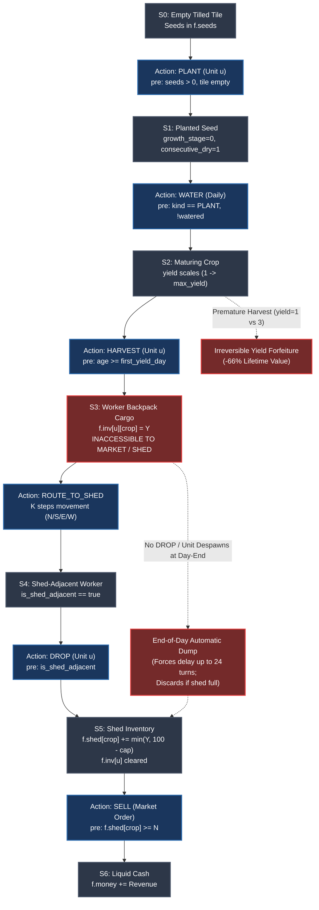

# PHASE 021: ACTION-DEPENDENCY & STATE-TRANSITION GRAPH

**Date**: 2026-09-20  
**Phase**: PHASE021 — AEC Capability, Action-Space & Dependency Completeness Audit  
**Chassis Ground Truth**: C++ `sim.hpp` / `kagsim.cpp`  

---

## 1. Executive Summary

This document formalizes the Kagriculture state-transition graph, explicitly detailing asset localization, intermediate states, and indirect transitions. 

A critical flaw identified in earlier compiler passes was treating the production-to-revenue cycle as a 2-node graph (`HARVEST -> CASH`), whereas the actual physical engine requires a 5-node constrained DAG (`MATURE_TILE -> BACKPACK_INVENTORY -> SHED_ADJACENT_WORKER -> SHED_INVENTORY -> LIQUID_CASH`).

---

## 2. Complete Physical Asset Lifecycle DAG



---

## 3. Annotated State Transitions

### Transition T1: Seeding
- **Transition**: `State(Empty, Seeds[c] >= 1)` $\xrightarrow{\text{PLANT}}$ `State(PlantedTile, Seeds[c] - 1)`
- **Affected State**: `tile.kind = T_PLANT`, `tile.consecutive_dry = 1`, `f.seeds[c] -= 1`.
- **Preconditions**: `tile.kind == T_EMPTY`, `seeds[c] > 0`, atomic validation across all submitted unit actions.
- **Dependency Effects**: If total submitted `PLANT` actions for crop $c$ across all units exceed `f.seeds[c]`, **ALL** plantings of crop $c$ fail this turn.
- **Reversibility**: Irreversible. Seed is consumed. Tile can only be cleared via `DIG` with zero refund.

### Transition T2: Crop Maturation & Watering
- **Transition**: `State(PlantedTile, watered=false)` $\xrightarrow{\text{WATER}}$ `State(PlantedTile, watered=true, yield+=bonus)`
- **Biological Growth Function**:
  - Non-ongoing crops (WHEAT, CARROT, MELON): If age $\in [\lfloor(max\_day + 1)/2\rfloor, max\_day]$, watering increases `yield_units` by +1 (or +2 if fertilized) up to `max_yield`.
  - Missing watering during this window permanently caps terminal yield.
- **Reversibility**: Irreversible.

### Transition T3: The Harvest Boundary (Direct Unit Execution)
- **Transition**: `State(Tile(yield=Y), Unit_u(inv={}))` $\xrightarrow{\text{HARVEST}}$ `State(Tile(yield=0, empty if non-ongoing), Unit_u(inv={c: Y}))`
- **Asset Localization**:
  $$\Delta \text{tile.yield} = -Y, \quad \Delta \text{f.inv}[u][c] = +Y, \quad \Delta \text{f.shed}[c] = 0$$
- **INDIRECT ASSET TRAP**: The harvested goods do **NOT** enter global liquidity or the shed. They are localized to unit $u$'s personal backpack.
- **Market Sells Precondition**: `SELL` requires `f.shed[c] >= N`. Goods in `f.inv[u]` **cannot be sold**.
- **Animal Feed Precondition**: `FEED` requires `f.inv[feeder][WHEAT] >= 1`. If worker $u$ holds wheat, farmer $0$ cannot feed livestock with it.
- **Reversibility**: **STRICTLY IRREVERSIBLE**. The plant is destroyed (non-ongoing) and cannot be unharvested.

### Transition T4: Transit to Shed
- **Transition**: `State(Unit_u at (x,y))` $\xrightarrow{K \times \text{MOVE}}$ `State(Unit_u at Shed-Access Tile)`
- **Path Length**: $K = |x - 4.5| + |y - 4.5| - 0.5$ steps.
- **Preconditions**: Collision-free path. (Movement fails if target tile is occupied by another unit or is off-board).
- **Opportunity Cost**: Worker consumes $K$ turns in transit, unable to perform production tasks.

### Transition T5: Deposit to Shed
- **Transition**: `State(Unit_u at Shed, inv={c: Y}, shed_total=S)` $\xrightarrow{\text{DROP}}$ `State(inv={}, shed[c]+=min(Y, 100-S), discarded+=max(0, Y-(100-S)))`
- **Preconditions**: `is_shed_adjacent(x, y) == true`.
- **Capacity Constraint**: If $S + Y > 100$, excess goods are **silently and permanently discarded**.
- **Reversibility**: Irreversible.

### Transition T6: Market Liquidation
- **Transition**: `State(shed[c] >= N, MarketInv = M)` $\xrightarrow{\text{SELL c N}}$ `State(shed[c] - N, Cash + Rev, MarketInv + N)`
- **Price Impact**: Incremental supply depresses future market clearing price via $M(I)$.
- **Reversibility**: Irreversible.

---

## 4. The Diurnal Reset Transition (End-of-Day Boundary)

At steps $t = 23, 47, 71, \dots, 719$ (Turn 23 of each Day):
```text
State(Farmhands = 1..H, Inventories) ---> End-of-Day Transition ---> State(Farmhands = 0, Farmer at (4,4))
```
1. `drop_inventories(f)`: All units dump backpacks into `f.shed`. Excess over 100 is discarded.
2. `f.n_units = 1`: **All auxiliary farmhands despawn**.
3. `f.pos_x[0] = 4, f.pos_y[0] = 4`: The farmer teleports back to home shed tile `(4, 4)`.
4. `f.hires_today = 0`: Hire counters reset to zero.

### Critical Topological Implication
Auxiliary farmhands **cannot hold state across day boundaries**. Any action assigned to a farmhand that is not completed and deposited before Turn 23 of the day is forcibly terminated by the engine reset, relying on the automatic end-of-day drop.
