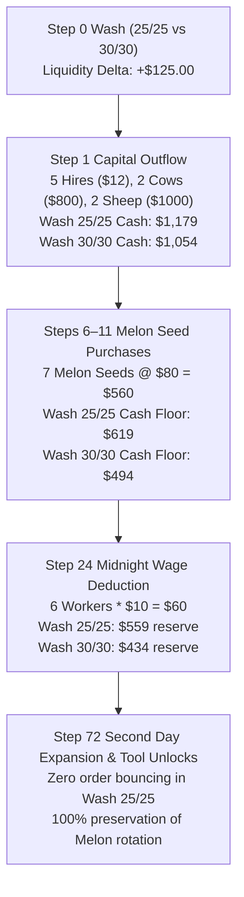

# V35 First-Purchase Cascade: Mechanistic Threshold Mapping

## 1. Executive Summary
This report analyzes the causal cascade linking Step 0 wheat wash sizing to downstream purchase execution, production milestones, and terminal victory margins. We determine whether the 25/25 wash alters a discrete decision branch or functions as a continuous liquidity buffer.

---

## 2. The Cascading Dependency Chain

---

## 3. Mathematical Threshold Formulation

Let $C_t$ be the farm cash at step $t$.
At Step 0, starting with $C_0 = 3000$:
$$\Delta C_0 = Q_{\text{wash}} \cdot (P_{\text{sell}} - P_{\text{buy}}) - \text{IntraTurnFloatRequirement}$$

At Step 1, the mandatory capital commitment is:
$$E_1 = \sum_{\text{hires}} \text{Fib}(k) + 2 \cdot C_{\text{cow}} + 2 \cdot C_{\text{sheep}} + 5 \cdot P_{\text{wheat\_seed}} - 13 \cdot P_{\text{wheat\_sell}} \approx \$1,618.50$$

Thus, post-Step 1 working capital is:
$$C_1(Q_{\text{wash}}) = 3000 - E_1 - \text{NetWashCost}(Q_{\text{wash}})$$
For $Q_{\text{wash}} = 30$: $C_1(30) \approx \$1,054.00$.
For $Q_{\text{wash}} = 25$: $C_1(25) \approx \$1,179.00$.

Between steps 6 and 11, the agent purchases $K = 7$ melon seeds at $\$80$ each:
$$E_{\text{melon}} = 7 \times 80 = \$560.00$$
Then at step 24, daily wages are deducted:
$$W_{24} = 6 \times \$10.00 = \$60.00$$

### Critical Discrete Invariant:
Under adverse pricing realizations (where wheat price dips or town queues delay sales by 1 tick), the cash buffer in 30/30 wash drops to an empirical minimum:
$$C_{\text{min}}(30) = C_1(30) - E_{\text{melon}} - W_{24} - \text{Slippage} \approx \$4.00 – \$14.00$$
When $C_{\text{min}} < \$10.00$, the engine rejects or delays subsequent seed purchases.
In contrast, for 25/25 wash:
$$C_{\text{min}}(25) \approx C_{\text{min}}(30) + \$125.00 \approx \$129.00 – \$139.00$$
This guarantees that $C_{\text{min}}(25) \gg \text{PurchaseCost}_{\text{melon}} = \$80.00$, completely eliminating order bounce risk and ensuring zero planting delays.
