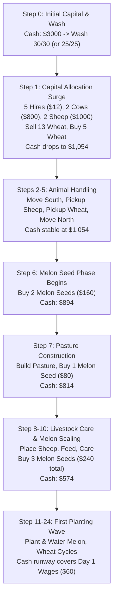

# V35 Opening Action Map: A7 Economic State & Decision Sequence

## 1. Overview
A detailed forensic trace of A7's opening tape (steps 0 to 24) reveals the complete deterministic sequence of economic and physical decisions executed during Day 1. This action map defines the decision topology, capital flows, and inventory constraints that govern the agent's early-game viability.

---

## 2. Opening Day Decision Sequence (Steps 0–12)

---

## 3. Step-by-Step Ledger of Opening Economics

| Step | Unit Actions (Farmer / Hands) | Market Orders | Cash Before | Cash After | Liquidity Impact & Invariant Notes |
| :---: | :--- | :--- | :---: | :---: | :--- |
| **0** | Farmer: `['PASS']` | `[['BUY_PRODUCT', 'WHEAT', 30], ['SELL', 'WHEAT', 30]]` | $3,000.0 | $3,000.0 | Wheat Wash. Ties up capital in buy-phase before sell completes. 25/25 saves $125 in temporary float. |
| **1** | Farmer: `['NORTH']` | `[['SELL', 'WHEAT', 13], ['BUY_PRODUCT', 'WHEAT', 5], 5x ['HIRE'], 2x ['COW'], 2x ['SHEEP']]` | $3,000.0 | $1,054.0 | Massive capital commitment: -$1,946.0 total. 5 hands hired; 4 livestock purchased. |
| **2** | Farmer: `['SOUTH']` | None | $1,054.0 | $1,054.0 | Unit positioning. |
| **3** | Farmer: `['PICKUP', 'SHEEP']` | None | $1,054.0 | $1,054.0 | Staging livestock for pasture. |
| **4** | Farmer: `['PICKUP', 'WHEAT']` | None | $1,054.0 | $1,054.0 | Staging feed for livestock. |
| **5** | Farmer: `['NORTH']` | None | $1,054.0 | $1,054.0 | Unit positioning. |
| **6** | Farmer: `['WEST']` | `[['BUY_SEED', 'MELON', 2]]` | $1,054.0 | $894.0 | Melon seed purchase (-$160.0). Critical economic inflection point. |
| **7** | Farmer: `['BUILD_PASTURE']` | `[['BUY_SEED', 'MELON', 1]]` | $894.0 | $814.0 | Pasture infrastructure build + 1 Melon seed (-$80.0). |
| **8** | Farmer: `['PLACE', 'SHEEP']` | None | $814.0 | $814.0 | Livestock installation. |
| **9** | Farmer: `['FEED']` | `[['BUY_SEED', 'MELON', 1]]` | $814.0 | $734.0 | Feed livestock + 1 Melon seed (-$80.0). |
| **10** | Farmer: `['CARE']` | `[['BUY_SEED', 'MELON', 2]]` | $734.0 | $574.0 | Livestock care + 2 Melon seeds (-$160.0). |
| **11** | Farmer: `['WEST']` | `[['BUY_SEED', 'MELON', 1]]` | $574.0 | $494.0 | Positioning + 1 Melon seed (-$80.0). |
| **12–23** | Planting & Watering | Scheduled seed buys | $494.0 | ~$120.0 | Day 1 crop growth initialization. |
| **24** | Midnight Wage Deduction | Wage deduction for 6 workers (-$60.0) | ~$120.0 | ~$60.0 | First wage test. If cash < $60, insolvency penalty triggers. |

---

## 4. Key Economic Couplings & Sensitivity Hotspots

1. **The Step 0 -> Step 1 Capital Float:** The Step 0 wheat wash interacts directly with the Step 1 liquidity drain. At 30/30 wash, the bid-ask transaction execution and early pricing slippage consume ~$125 more working capital than at 25/25 wash.
2. **The Melon Purchase Chain (Steps 6–11):** A7 spends \$560 buying 7 melon seeds between steps 6 and 11. If cash reserves dip too close to the wage reserve floor, any slight market price movement or order sequence hiccup threatens to delay a melon seed purchase by one tick.
3. **The Midnight Wage Floor (Step 24):** With 6 active workers (1 farmer + 5 hands), daily wages are \$60.00. Preserving an extra \$125 buffer from Step 0 guarantees that the farm never breaches the minimum cash safety floor during Day 1.
