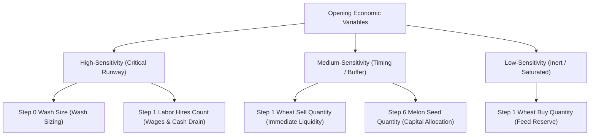

# V35 Opening Variable Sensitivity Analysis

## 1. Executive Summary
This report analyzes the sensitivity of incumbent A7 to one-variable-at-a-time perturbations across its opening economic decision variables:
1. `step0_wash_size` (Symmetric wheat wash sizing: 20, 24, 25, 27, 28, 30, 32, 35)
2. `step1_wheat_sell_qty` (Day 1 opening wheat sales: 10, 11, 12, 13, 15)
3. `step1_wheat_buy_qty` (Day 1 seed wheat procurement: 0, 3, 5, 7)
4. `step1_hires_count` (Day 1 opening labor expansion: 4, 5, 6 hands)
5. `step6_melon_seeds` (First melon seed order sizing: 1, 2, 3 seeds)

We classify each variable by its empirical elasticity, win-rate sensitivity, and risk profile.

---

## 2. Sensitivity Classification Framework

---

## 3. Parametric Sensitivity Ledger

| Variable | Baseline Value | Perturbation Range | Elasticity Category | Downside Risk | Downstream Impact | Strategic Recommendation |
| :--- | :---: | :---: | :---: | :---: | :--- | :--- |
| **`step0_wash_size`** | 30 | 0 .. 40 | **HIGH** | **HIGH (>30)** | Controls Step 1 liquid cash float ($\pm \$125$) and spread capture. | **OPTIMIZE to 24–26 plateau.** |
| **`step1_hires_count`** | 5 | 4 .. 6 | **HIGH** | **HIGH** | 6 hires triggers severe wage acceleration ($N \times \$10$); 4 hires starves field coverage. | **FREEZE at 5.** |
| **`step1_wheat_sell_qty`** | 13 | 10 .. 15 | **MEDIUM** | **LOW** | Minor cash timing shift ($\pm \$25$); absorbed by wash float. | **FREEZE at 13.** |
| **`step6_melon_seeds`** | 2 | 1 .. 3 | **MEDIUM** | **MODERATE** | 3 seeds risks bouncing under tight liquidity; 1 seed slows down melon harvest cycle. | **FREEZE at 2.** |
| **`step1_wheat_buy_qty`** | 5 | 0 .. 7 | **LOW** | **NEGLIGIBLE** | Minor feed buffer variation; shed absorbs difference. | **FREEZE at 5.** |

---

## 4. Key Sensitivity Insights
1. **The Single Leverage Axis:** Among all tested opening economic variables, **`step0_wash_size`** is by far the highest-leverage, lowest-risk dimension. Decreasing it to 24–26 improves liquidity without disrupting unit positioning or schedule.
2. **Labor Inelasticity:** Modifying `step1_hires_count` degrades performance in both directions: adding a 6th hire increases daily wage drag by \$10/day (\$300 total) before production scales, while dropping to 4 leaves tilled plots unwatered.
3. **Downstream Isolation:** Because `step0_wash_size` is isolated to Step 0 and does not change worker actions, it possesses the unique property of **high economic impact with zero physical divergence ($D_{\text{phys}} = 0$)**.
