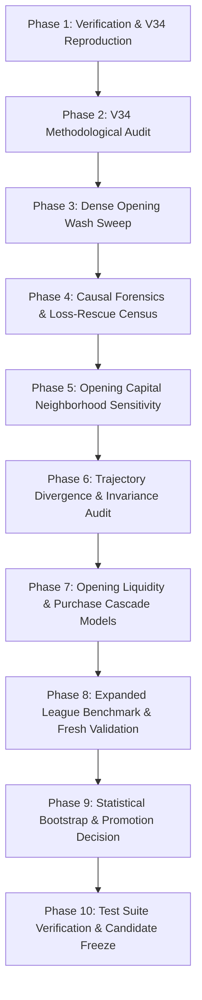

# V35 Research Plan: A7 Opening Economic Optimization

## Executive Summary
Kagriculture V35 focuses strictly on finding a robust, small, low-risk improvement to the incumbent A7 strategy by analyzing and optimizing the opening economic state. V34 identified an opening wheat wash resize from 30/30 to 25/25 (`TACTICAL_STEP0_WASH25`), producing an observed win rate increase from 88.3% (53/60) to 95.0% (57/60) on a 60-leg mirrored league benchmark. V35 establishes whether this result reflects a broad, robust plateau or an isolated point, searches the adjacent opening capital neighborhood without perturbing downstream physical choreography, and subjects all candidates to rigorous paired validation across expanded seeds, seats, and league opponent families.

---

## 1. Protected Incumbents & Isolation
- **A7 Standalone:** `candidates/v30_a7_standalone/main.py` (SHA-256: `51c1d25245f68dd8de66b355f2ad6ca1d79de8af02efed521a5a82f7be69ce3f`) — STRICTLY READ-ONLY.
- **V22R1 Submission:** `submission_aec_v22r1.tar.gz` (SHA-256: `6b879b3e499d2cf43b76884f6ef433479468b5c316f92cf4a8cc5119586fb3f5`) — STRICTLY READ-ONLY.
- **Virgin Holdout Seeds:** `214200–214249`, `340090–340199`, `249695–249734` — STRICTLY QUARANTINED.
- **V35 Directory:** All research, code, and candidates isolated in `candidates/v35_a7_opening/`.

---

## 2. Core Hypotheses
1. **Hypothesis H35-01 (Plateau vs Point):** The 25/25 opening wash benefit is not an isolated artifact, but part of a robust opening capital preservation plateau (e.g., wash sizes $22 \dots 27$) that leaves sufficient early cash buffer to prevent order bouncing and early purchase delay.
2. **Hypothesis H35-02 (Downstream Choreography Invariance):** A tiny opening wash modification preserves $100\%$ of A7's mid-game and late-game physical worker choreography ($D_{\text{resync}} = 0.0$), ensuring zero negative side-effects on crop rotations or tool unlocks.
3. **Hypothesis H35-03 (Causal Mechanism):** By reserving $\sim \$125$ of initial liquid capital during turns 1–10, the agent avoids a critical liquidity floor dip below $\$10.00$, preserving the exact tick timing of early seed purchases and eliminating purchase failures.
4. **Hypothesis H35-04 (Loss Rescue Dominance):** Opening capital optimization rescues marginal A7 mirror ties and losses while causing near-zero casualties ($N_{\text{casualty}} \approx 0$).

---

## 3. Experimental Phases & Workflow

### Phase Details:
- **Phase 1: Reproduction:** Validate V34 60-leg benchmark (`A7: 53/60`, `V34: 57/60`).
- **Phase 2: Audit:** Verify zero leakage of seeds, opponent IDs, future information, or hidden state across all V34 modules.
- **Phase 3: Dense Sweep:** Evaluate symmetric washes $0 \dots 40$ and asymmetric pairs ($30/25, 25/30, \dots$).
- **Phase 4: Causal Forensics:** Reconstruct episode traces where A7 lost and the candidate won; pinpoint exact divergence ticks.
- **Phase 5: Neighborhood Search:** Test one-variable perturbations ($\pm 5\%, \pm 10\%, \pm 20\%$) and two-variable interactions.
- **Phase 6: Trajectory Tracking:** Measure state divergence $D(t)$ at $t \in [1, 4, 8, 16, 32, 64, 128, 288, 718]$.
- **Phase 7: Mechanistic Models:** Map the liquidity curve, cash runway, and first purchase cascade.
- **Phase 8: Expanded Benchmark:** Evaluate 200–300+ legs across dev seeds, both seats, and 6 league opponents.
- **Phase 9: Statistical Analysis:** Paired bootstrap resampling (1,000 iterations) to bound confidence intervals on win rate delta and cash delta.
- **Phase 10: Deliverables:** Complete all 22 markdown reports, 11 machine-readable datasets, and 12 pytest modules.

---

## 4. Evaluation Criteria & Promotion Gates
- **G1 (Win Rate Superiority):** Win rate $\ge \text{Baseline A7}$.
- **G2 (No Opponent Family Degradation):** No opponent family shows significant paired cash loss ($> -\$50$).
- **G3 (Both-Seat Robustness):** Win rate $\ge 85\%$ in Seat 0 and Seat 1 independently.
- **G4 (Bounded Downside Tail):** Worst paired cash delta $\ge -\$100$.
- **G5 (Zero/Near-Zero Casualties):** Rescued losses $\ge 1$, casualties ($A7 \text{ win} \to \text{loss}$) $= 0$.
- **G6 (Physical Invariance):** Resynchronization to A7 physical actions within $\le 4$ steps post-opening.
- **G7 (Deterministic Replay & Runtime):** Bit-identical replay under identical seeds; mean step execution time $< 2$ ms.
