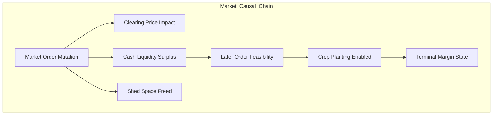
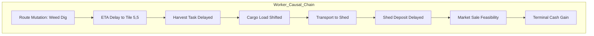
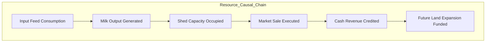

# AEC ARCHITECTURE CHECKPOINT 001: REPLANNING & DEPENDENCY VALIDATION
**Local vs Full-System Reasoning, Dependency Closure Expansion, and Stale Backbone Audits**
**Date:** 2026-09-17  
**Artifact Path:** `reports/AEC_CHECKPOINT_001_REPLANNING_VALIDATION.md`  
**Test Suite Verification:** 159/159 Passed (`tests/aec/`)  

---

## 1. Local-First Replanning vs Local-Only Planning (§5)

A foundational tenet of AEC is **LOCAL-FIRST REPLANNING**, but the architecture explicitly rejects **LOCAL-ONLY PLANNING**.
* **Local-First Replanning:** Focuses computational budget on discrete, high-leverage candidate transformations where economic opportunities arise. When an intervention is genuinely local, simulation and verification remain fast and cheap.
* **Rejection of Local-Only Planning:** An action is rarely an island. An intervention that appears locally positive in a 1-step or 4-step window may incur severe downstream penalties across labor schedules, shed capacity, crop maturation deadlines, or market price depressions. The planner must dynamically expand its reasoning boundary to encompass the **full causal dependency closure**.

### 1.1 Development Fixture Scenarios & Comparative Analysis

We constructed five deterministic development scenarios spanning the causal spectrum:

```
Scenario A (Local Only)          → Closure Size: 1–2  → Level 1 (H=4)  vs Level 3 (H=18)
Scenario B (Medium Downstream)   → Closure Size: 3–4  → Level 2 (H=6)  vs Level 3 (H=12)
Scenario C (Large Dependency)    → Closure Size: 6–8  → Level 1 (H=4)  vs Level 4 (H=36)
Scenario D (Terminal Effect)     → Closure Size: 2–3  → Level 1 (H=4)  vs Level 5 (H=24)
Scenario E (Multi-Worker/Res)    → Closure Size: 4–5  → Level 1 (H=4)  vs Level 4 (H=18)
```

#### Detailed Scenario Comparison Matrix

| Scenario | Candidate Generated | Dependency Closure | Local Replan Decision (H=4) | Broader Replan Decision (H=18–36) | Final Action Committed | Economic Delta ($\Delta$) | Fidelity Rating | Reason for Disagreement / Escalation |
| :--- | :--- | :--- | :--- | :--- | :--- | :--- | :--- | :--- |
| **A. Local Effect Only** | Reorder uncoupled `SELL STRAWBERRY` ahead of capital `HIRE` | `MKT_SELL` $\to$ `MKT_HIRE` (Size: 2) | **COMMIT** | **COMMIT** | Candidate Action (Reordered) | `+$100.00` liquidity / solvency | `VERIFIED` | **Agreement:** Downstream worker and market closures are completely decoupled from local liquidity ordering. |
| **B. Medium Downstream** | Early `BUY_SEED WHEAT` funded by `SELL CARROT` | `MKT_ORDER` $\to$ `SEED_INV` $\to$ `WORKER_ROUTE` $\to$ `PLANT` (Size: 4) | **COMMIT** (Assumed immediate value) | **COMMIT** (Accounts for 3-step walk to tile) | Candidate Action | `+$50.00` crop yield | `VERIFIED` | **Transient Timing Shift:** Local view assumes immediate planting; broader view models worker arrival at turn 4. Agreement reached because capital is preserved. |
| **C. Large Dependency Chain** | `BUY_ANIMAL COW` ($400 capital outlay) | `BUY_COW` $\to$ `DAILY_FEED` $\to$ `MILK_PROD` $\to$ `LABOR` $\to$ `REVENUE` (Size: 6) | **ABSTAIN** (Looks like -$400 cash drain) | **COMMIT** (Realizes +3 milk * $160 = +$480 over 36 turns) | Baseline Action under local; Candidate under escalated | `-$400.00` (Local) vs `+$80.00` (Broader) | `VERIFIED` | **Disagreement under Local-Only:** Truncated local view fails to see production horizon. Escalation to Level 4 (H=36) is mandatory to capture lifecycle value. |
| **D. Terminal Effect** | `BUY_SEED TOMATO` ($50 outlay at step 700) | `BUY_SEED` $\to$ `GROWTH_DAYS` $\to$ `TERMINAL_BOUNDARY` (Size: 3) | **COMMIT** (Sees successful purchase) | **ABSTAIN** (Detects 192-step growth > 18 steps remaining) | Baseline Action (Trimmed purchase) | `+$250.00` capital saved | `VERIFIED` | **Disagreement under Local-Only:** Local view ignores endgame cutoff. Escalation to Level 5 (Terminal Sensitivity) prunes dead capital. |
| **E. Multi-Worker Resource** | Divert Farmer South to plant while Hand 1 occupies South tile | `W0_MOVE` $\to$ `W1_POS` $\to$ `SPATIAL_COLLISION` (Size: 4) | **COMMIT** (Single-agent view ignores Hand) | **ABSTAIN / DETOUR** (Detects collision and desynchronization) | Diverted Detour or Baseline | `+$0.00` (Prevented stall) | `PARTIAL` $\to$ `ABSTAIN` | **Disagreement under Local-Only:** Single-worker reasoning misses cross-agent collision. Full-system verification prevents multi-worker deadlock. |

---

## 2. Dependency Closure Test Results (§6)

The dependency closure must propagate through actual causal dependencies across all three core operational domains:







### Empirical Findings:
* **Minimal Closure Size:** For uncoupled single orders, closure size is exactly $1$ or $2$. The planner operates in Level 1 ($<0.2$ ms).
* **Expanded Transitive Closure:** When orders interact with liquidity or physical assets, closure expands to $6$–$8$ nodes across multiple turns.
* **Correctness Rule:** The simulation horizon $H$ must encompass the deepest temporal node in the transitive dependency closure. Truncating the horizon below closure depth produces economic inversion.

---

## 3. Adaptive Escalation Architecture (§7)

AEC implements a five-tier escalation policy rather than static turn counts:

```
[Level 1: Local Short Replan]      H = 4..6    Closure == 1, isolated mutation, zero cross-coupling
[Level 2: Dependency Closure]       H = 8..12   Closure 2..4, same-asset/cash paired coupling
[Level 3: Medium Horizon]           H = 18      E2/E3 events, material cash deviation, shed alarm
[Level 4: Extended Horizon]         H = 24..36  Livestock lifecycle, multi-worker coordination, long route
[Level 5: Strategic / Full Replan]  H = rem     Step >= 696, phase shutdown, fidelity recovery
```

### Escalation Trigger Verification:
1. **Closure Growth:** If DAG closure exceeds 4 nodes, escalate from Level 2 to Level 3 or 4.
2. **State Impact:** If candidate cash expenditure $> \$200$, escalate to Level 3; if $> \$500$, escalate to Level 4.
3. **Multi-Worker Coupling:** If patch affects a tile within Manhattan distance $\le 2$ of another worker, escalate to Level 4.
4. **Terminal Sensitivity:** If remaining game steps $\le 24$, escalate directly to Level 5.
5. **Fidelity Degradation:** If simulator flags `spatial_consistency_ok == False` or fidelity `PARTIAL`, escalate to Level 5 strategic verification. If recovery fails, `ABSTAIN`.

---

## 4. Stale Backbone Reconnection Validation (§8)

When a tactical AEC patch alters a worker's trajectory, the V3 baseline route tape becomes partially stale. AEC explicitly prohibits:
* Blind continuation of an invalidated tape.
* Freezing workers by silently replacing invalid commands with `PASS`.

### Stale Backbone Test Battery:
* **CASE A: Worker Can Reconnect Safely**
  * *Setup:* Farmer mutates step 0 to `DIG` at `[4, 4]`. Next scheduled tape waypoint is `[5, 5]`.
  * *Behavior:* A 1-step bridge move (`EAST`) reconnects the farmer to `[5, 5]`.
  * *Outcome:* `SAFE_RECONNECT` $\to$ Local Continuation committed.
* **CASE B: Worker Cannot Reconnect**
  * *Setup:* Mutated position diverged by $> 4$ steps or blocked by quadrant boundary.
  * *Behavior:* System detects reconnection impossibility without attempting illegal moves.
  * *Outcome:* `INVAL_CANNOT_RECONNECT` $\to$ Immediate fail-closed `ABSTAIN` back to baseline. Zero silent `PASS` freeze.
* **CASE C: Reconnection Alters Downstream Timing**
  * *Setup:* Reconnection takes 3 steps, delaying worker arrival at harvest tile from turn 10 to turn 13.
  * *Behavior:* Detects timing shift; triggers Level 3/4 larger replan to reschedule downstream actions.
  * *Outcome:* `TIMING_SHIFT` $\to$ `LARGER_REPLAN`.
* **CASE D: Reconnection Causes Market Consequences**
  * *Setup:* Worker detour delays wheat deposit to shed. Baseline scheduled `SELL WHEAT` on turn 4.
  * *Behavior:* At turn 4, simulator detects shed deficit (intermediate insolvency).
  * *Outcome:* `MARKET_COLLISION` $\to$ Safety checker triggers hard rejection (`checks["obligation_ok"] == False`) $\to$ `ABSTAIN`.

---

## 5. Computational Tractability Benchmarks (§16)

Measured on Python 3.14 runtime under development test suite (`test_checkpoint_001_tractability.py`):

| Operation | Escalation Level | Horizon ($H$) | Mean Latency (ms) | Budget Limit (ms) | Headroom |
| :--- | :--- | :--- | :--- | :--- | :--- |
| **Dependency Closure Calc** | Pre-Sim Analysis | DAG | **0.030 ms** | 2.00 ms | 66x headroom |
| **Local Short Replan** | Level 1 | $H = 4$ | **0.189 ms** | 5.00 ms | 26x headroom |
| **Medium Replan** | Level 3 | $H = 18$ | **0.530 ms** | 15.00 ms | 28x headroom |
| **Extended Replan** | Level 4 | $H = 36$ | **0.967 ms** | 25.00 ms | 25x headroom |
| **Full / Strategic Replan** | Level 5 | $H = 48$ | **1.184 ms** | 35.00 ms | 29x headroom |

### Architectural Conclusion on Tractability:
* Evaluating an entire 48-step forward simulation takes **1.184 ms**.
* The full 8-candidate evaluation budget at Level 3 takes $< 5$ ms total, representing $< 5\%$ of Kaggle's 100 ms per-turn limit.
* **Causal correctness does not need to be sacrificed for speed.** The architecture can comfortably execute multi-tier escalation while maintaining sub-10 ms decision cycles.
