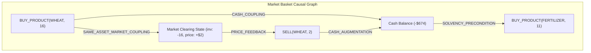
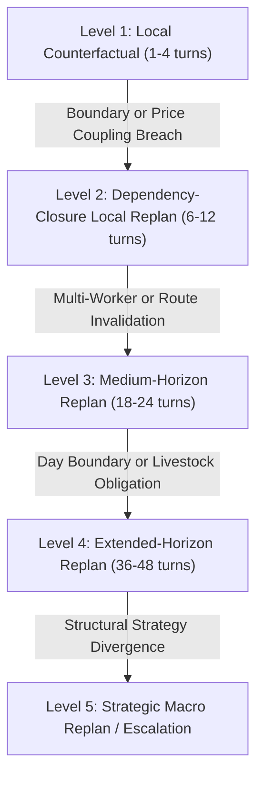

# AEC Dependency Graph & Adaptive Replanning Architectural Design

**Specification Identifier:** `DESIGN-AEC-DEP-001`  
**Date:** 2026-09-17  
**Context:** AEC Architecture Evolution following `EXP-AEC-002`  
**Governance Scope:** Foundation for Causal Dependency Modeling, Adaptive Escalation, and Counterfactual Parity.

---

## 1. Architectural Philosophy: From Action-by-Action to Patch Causality

In early AEC prototypes, candidate patches and action baskets were treated as flat arrays of independent operations:
$$\text{Basket} = [a_1, a_2, a_3, \dots, a_k]$$
Evaluation evaluated each action as if its economic consequences were strictly local and separable. `EXP-AEC-002` definitively falsified this assumption:
- In the real engine, actions within a single basket mutate shared state variables (market clearing prices, cash balances, shed capacities, worker coordinates).
- Reordering two actions ($a_1$ and $a_2$) changes the state trajectory seen by $a_2$, altering clearing prices, feasibility, and downstream solvency.

The core architectural paradigm of AEC is therefore redesigned around **Patch Causality**:
$$\text{Observation} \longrightarrow \text{Economic IR} \longrightarrow \text{Candidate Patch} \longrightarrow \text{Dependency Closure} \longrightarrow \text{Counterfactual Simulation} \longrightarrow \text{Safety Certificate}$$

When AEC evaluates a candidate patch, the planner asks three fundamental causal questions:
1. **Direct Impact:** *What state variables does this patch mutate immediately?*
2. **Causal Propagation:** *What downstream decisions, orders, or routes depend on those mutated variables?*
3. **Dependency Closure:** *How far does this causal influence propagate before stabilizing or requiring escalation?*

---

## 2. Action Basket Dependency Graph Architecture

Rather than a flat list, an action basket is modeled as a Directed Acyclic Graph (DAG):
$$G = (V, E)$$
Where:
- $V = \{v_1, v_2, \dots, v_n\}$ represents individual action nodes (e.g. `BUY_PRODUCT(WHEAT, 16)`, `SELL(WHEAT, 2)`, `WORKER_MOVE(W0, NORTH)`).
- $E = \{(u, v, \text{type})\}$ represents directed causal dependency edges.



### 2.1 Authoritative Causal Edge Taxonomy

The dependency graph supports seven distinct classes of economic coupling:

1. **Same-Asset Market Coupling (`SAME_ASSET_MARKET_COUPLING`):**
   - *Definition:* An order mutating inventory of commodity $C$ directly alters the clearing price for all subsequent orders involving commodity $C$.
   - *Mathematical Form:* $\frac{\partial P_C}{\partial Q_C} \neq 0$. Buying unit $k$ drives price up: $P(I - 1) > P(I)$. Selling unit $k$ depresses price: $P(I + 1) < P(I)$.
   - *Causal Rule:* Any reordering between buy and sell of asset $C$ must evaluate the integrated price trajectory $\int P_C(q) \, dq$.
2. **Cross-Asset Market Coupling (`CROSS_ASSET_MARKET_COUPLING`):**
   - *Definition:* Coupling across distinct commodities mediated by town-center or shop substitution dynamics.
   - *Game Semantics:* In Kagriculture, commodity clearing prices are technically decoupled in the central market, but coupled via town shop consumption ticks every 4 steps.
3. **Cash Coupling (`CASH_COUPLING`):**
   - *Definition:* An earlier expenditure reduces available liquid funds for subsequent purchases in the same or later turns.
   - *Precondition:* Order $k$ requires $M \ge \text{Price}_k$. If Order $j < k$ expends cash such that $M' < \text{Price}_k$, Order $k$ fails.
4. **Inventory Coupling (`INVENTORY_COUPLING`):**
   - *Definition:* A sell order requires shed inventory: $\text{Shed}[C] \ge Q_{\text{sell}}$. A buy order requires shed capacity: $\sum \text{Shed} + Q_{\text{buy}} \le 100$.
5. **Capacity Coupling (`CAPACITY_COUPLING`):**
   - *Definition:* Worker cargo limits ($4$ or $6$ units) and shed ceiling ($100$ units). If harvest or pickup exceeds capacity, units are dropped or lost.
6. **Obligation Coupling (`OBLIGATION_COUPLING`):**
   - *Definition:* End-of-day livestock feeding obligations. If wheat is sold or consumed before step 30/60/..., livestock starves, destroying animal capital.
7. **Timing Coupling (`TIMING_COUPLING`):**
   - *Definition:* Crop maturation and phase shutdown deadlines. Planting past step $720 - T_{\text{mat}}$ produces zero terminal yield.

---

## 3. Dependency Closure & Affected Subgraph Expansion

When an opportunity proposes a mutation $\Delta a$, the engine computes the **Dependency Closure**:
$$\mathcal{C}(\Delta a) = \{ u \in V \mid u \text{ is reachable from } \Delta a \text{ via causal edges in } G \}$$

### 3.1 Algorithm: Compute Dependency Closure

```python
def compute_dependency_closure(patch, baseline_action, econ_state):
    affected_nodes = set(patch.mutated_entities)
    frontier = list(affected_nodes)
    closure = set(affected_nodes)
    
    while frontier:
        current = frontier.pop(0)
        # Find downstream edges
        for neighbor, edge_type in get_causal_edges(current, baseline_action, econ_state):
            if neighbor not in closure:
                closure.add(neighbor)
                frontier.append(neighbor)
                
    return closure
```

---

## 4. Tiered Adaptive Replanning Architecture (Levels 1 to 5)

AEC rejects a fixed universal simulation horizon (e.g. always 24 or 48 steps). Instead, evaluation starts locally and escalates based on the size and economic risk of the dependency closure:



### 4.1 Specification of Escalation Levels

| Level | Name | Scope | Trigger Conditions | Continuation Handling |
|---|---|---|---|---|
| **Level 1** | Small Local CF | Horizon 1–4 turns | Isolated market reordering without price coupling; pure 1-step tactical patch. | Frozen V3 route tape preserved 100%. |
| **Level 2** | Dependency-Closure Replan | Horizon 6–12 turns | Same-asset market coupling; single-worker waypoint detour. | Replan mutated worker path back to target waypoint; preserve unaffected workers. |
| **Level 3** | Medium-Horizon Replan | Horizon 18–24 turns | Multi-worker coordination; cargo delivery rerouting; mature harvest sweep. | Local A* waypoint reconnection; simulate cargo delivery to shed. |
| **Level 4** | Extended-Horizon Replan | Horizon 36–48 turns | Crossing day boundary (steps 30, 60...); livestock feed security; animal purchasing. | Full daily lifecycle simulation: daily growth refresh, animal feeding, shed accounting. |
| **Level 5** | Strategic Macro Replan | Horizon 72+ turns | Farm quadrant expansion; town shop route restructuring. | Tactical AEC abstains and requests macro-planner review. |

---

## 5. Resolving Route Continuation Invalidation

A critical flaw identified in the audit was that mutating a worker's route at step 0 desynchronized the worker from the static backbone tape, causing the simulator to freeze the worker with `PASS` commands.

### 5.1 The Reconnect Continuation Protocol

When a candidate patch alters worker $w$'s trajectory from $P_0 \to P'_1$:
1. **Identify Anchor Waypoint:** Determine the worker's planned waypoint $P_{\text{anchor}}$ at step $t + K$ from the V3 backbone tape.
2. **Compute Local Reconnect Path:** Using grid pathfinding, compute the shortest collision-free path from $P'_1$ to $P_{\text{anchor}}$.
3. **Suture Trajectory:**
   - Steps $1 \dots K$: Worker executes the reconnect path.
   - Steps $K+1 \dots \text{Horizon}$: Worker resumes the planned V3 backbone tape from $P_{\text{anchor}}$.
4. **Preserve Unaffected Workers:** All other workers continue executing their unmodified backbone routes.
5. **Fidelity Verification:** If a collision-free reconnect path cannot be found within $K$ steps, flag `COUNTERFACTUAL_FIDELITY: FAILED` and `ABSTAIN`.

This protocol eliminates the artificial `spatial_desynchronized` failure mode while preserving the macro intent of the frozen V3 backbone.
