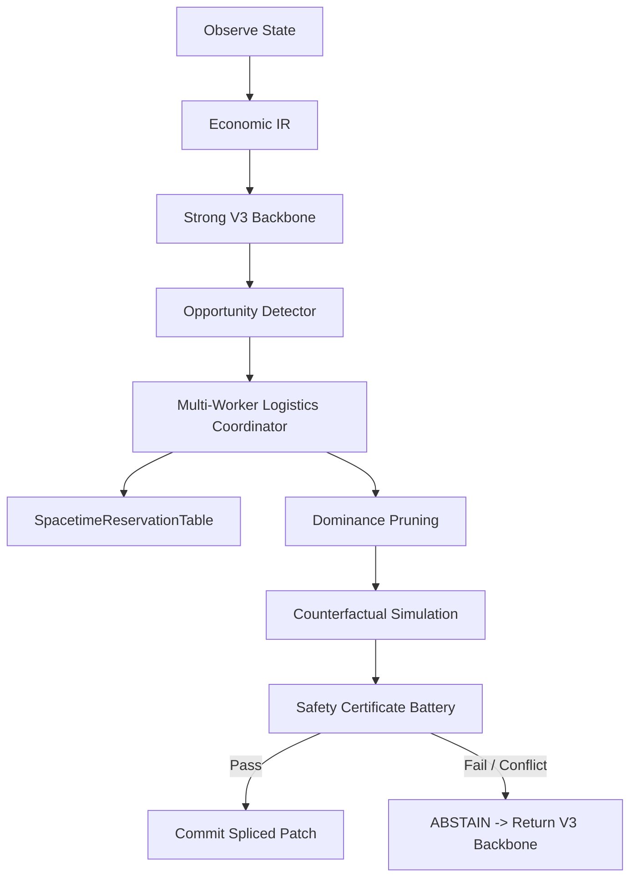

# AEC Phase 003: Multi-Worker Logistics Coordination Architecture

**Authoritative Architecture Specification**  
**Status**: ARCHITECTURALLY IMPLEMENTED & MICRO-VALIDATED  
**Phase**: AEC-003  
**Date**: 2026-09-18  

---

## 1. Executive Summary & Problem Formulation

### 1.1 The Labor Cannibalization Bottleneck
Across previous AEC milestones, physical deviations such as `RESOURCE_CONVERSION` and `EMERGENCY_FEED_PURCHASE` were constrained by single-worker assumptions. In Phase 002B and Phase 002C, diverting the primary worker (Farmer) to execute feed purchases or item processing caused severe economic regression: high-value harvest actions (yielding up to $160–$250 per product) and vital watering duties were abandoned.

AEC Phase 003 resolves this structural deficit by implementing **Multi-Worker Logistics Coordination**. Rather than replacing the authoritative frozen V3 backbone policy, Phase 003 introduces a deterministic logistics compiler that asks:
> *"Can this deviation be executed by an alternative worker (such as Hand 1 or Hand 2) while preserving the backbone's economically critical baseline obligations?"*

### 1.2 Core Architectural Objectives
1. **Exact Simulator Compliance**: Grounded strictly in C++ engine physics (`sim.hpp` and `kagsim.cpp`). Units 0 is the permanent Farmer; Units $1 \dots N-1$ are hired hands. All direct unit-to-unit handoffs are physically illegal and rejected; item exchange must pass through the shed (`OP_DROP` $\to$ `OP_PICKUP`).
2. **Marginal Labor Opportunity Cost**: Labor opportunity cost is computed directly from displaced baseline tasks, avoiding arbitrary constant shadow wages ($hire\_cost / 24$).
3. **Space-Time Collision & Contention Prevention**: Built on an extended `SpacetimeReservationTable` preventing vertex collisions, edge swaps, simultaneous structure building, and resource contention.
4. **Dominance-Pruned Bounded Scheduling**: Bounded search prioritizing obligation preservation, task absorption, and route efficiency.
5. **Fail-Closed Governance**: Any unmet deadline, unhandled obligation loss, or physical illegality triggers immediate `ABSTAIN -> BACKBONE`.

---

## 2. Core Worker & Task Data Models

### 2.1 Worker State & Capability Model (`worker_model.py`)
- **`WorkerType`**: `FARMER` (Unit 0) vs `HAND` (Units 1..N-1).
- **`WorkerCapability`**: Derived directly from the simulator action space:
  `{PASS, MOVE, PICKUP, DROP, PLACE, PLANT, WATER, HARVEST, FERTILIZE, DIG, BUILD_COOP, BUILD_PASTURE, FEED, COLLECT_FERTILIZER, CARE}`.
- **`WorkerState`**: Encapsulates `worker_id`, `worker_type`, `position`, `carried_inventory`, `availability_turn`, `capabilities`, `assigned_obligations`, and `movement_state`.

### 2.2 Task Model & Priority Hierarchy (`task_model.py`)
Work items are represented as discrete `WorkerTask` structures:
- `task_id`, `action_family`, `location`, `earliest_start`, `latest_completion`, `required_capabilities`, `duration`, `resource_inputs`, `resource_outputs`, `cash_effect`, `dependent_tasks`, `priority_class`, `is_mandatory`.
- **Explicit Priority Hierarchy (`TaskPriority`)**:
  1. `HARD_OBLIGATION` (1000)
  2. `TERMINAL_OBLIGATION` (900)
  3. `LIVESTOCK_SECURITY` (800)
  4. `RESOURCE_SECURITY` (700)
  5. `HIGH_VALUE_HARVEST` (600)
  6. `SCHEDULED_PRODUCTION` (500)
  7. `MARKET_ACTION` (400)
  8. `OPPORTUNISTIC_TASK` (100)

### 2.3 Task Dependency Graph (`TaskDependencyGraph`)
A strict DAG ensuring topological ordering:
$$\text{BUY\_FEED} \longrightarrow \text{PICKUP\_WHEAT} \longrightarrow \text{DELIVER/FEED\_ANIMAL} \longrightarrow \text{ANIMAL\_PRODUCTION}$$

---

## 3. Scheduling, Labor Opportunity Cost, & Dominance

### 3.1 Marginal Labor Opportunity Cost (`assignment.py`)
Rather than assigning an arbitrary monetary price to worker time, Phase 003 categorizes the outcome of every baseline task $T_{base}$:
- **`PRESERVED_BY_SELF`**: Executed on time by its original worker (either undisturbed or after route reconnection).
- **`ABSORBED_BY_PEER`**: Reassigned to an available peer worker without deadline violation.
- **`DELAYED_FEASIBLE`**: Postponed within acceptable tolerance before expiration.
- **`SUPERSEDED_OPTIONAL`**: An optional, low-priority baseline task (e.g. weed digging) intentionally replaced by a higher-value task.
- **`CANCELLED` / `INFEASIBLE`**: An obligation was dropped. If any mandatory obligation is lost, the candidate plan is flagged `is_acceptable = False` and rejected.

### 3.2 Multi-Worker Dominance Pruner (`dominance.py`)
Given candidate plans $P_A$ and $P_B$:
$P_A \succ P_B$ if:
1. $P_A$ is acceptable and $P_B$ is unacceptable.
2. $P_A$ loses strictly fewer mandatory obligations.
3. $P_A$ displaces strictly less economic value.
4. $P_A$ absorbs more tasks via peer workers.
5. $P_A$ achieves lower total transit steps.
6. $P_A$ preserves Farmer on specialized high-value harvesting.

---

## 4. Space-Time Reservation & Physical Invariants

### 4.1 Extended `SpacetimeReservationTable`
Reused from `aec/replanning/reconnect.py` and extended to support:
- **Vertex Reservation**: $(t, (x, y)) \mapsto \text{worker\_id}$
- **Edge Swap Reservation**: $(t, (x_1, y_1), (x_2, y_2)) \mapsto \text{worker\_id}$
- **Task Exclusivity**: $(t, \text{task\_id}) \mapsto \text{worker\_id}$
- **Resource Ownership**: $(t, \text{resource\_key}) \mapsto \text{worker\_id}$
- **Building Exclusivity**: $(t, (x, y)) \mapsto \text{worker\_id}$

### 4.2 Simulator Fidelity & Illegal Handoffs
In `sim.hpp`, units cannot directly transfer items tile-to-tile. Any multi-worker task plan requiring item exchange must explicitly specify a shed drop-and-pickup sequence:
1. Worker A moves adjacent to shed $\to$ `OP_DROP` / `OP_PLACE`.
2. Worker B moves adjacent to shed $\to$ `OP_PICKUP`.
Plans attempting direct handoffs are rejected immediately with `ABSTAIN_ILLEGAL_HANDOFF`.

---

## 5. Integration into AEC Compilation Pipeline

---

## 6. Safety Certificate Battery Extension

The safety checker (`aec/safety/checks.py`) now enforces 9 formal multi-worker invariants:
1. `worker_assignment_consistency`: Worker ID exists in active farm roster.
2. `worker_capability_validity`: Worker possesses all required action capabilities.
3. `worker_task_exclusivity`: No worker assigned simultaneous conflicting tasks.
4. `worker_spacetime_collision`: Zero vertex collisions or edge swaps.
5. `worker_resource_ownership`: Zero double-allocation of items or shed stocks.
6. `worker_task_deadline`: All task deadlines satisfied.
7. `worker_route_continuity`: Spatial step continuity ($L_1 \le 1$).
8. `worker_handoff_validity`: All item handoffs pass through shed access tiles.
9. `worker_baseline_obligation_preservation`: Zero mandatory baseline obligations lost.
