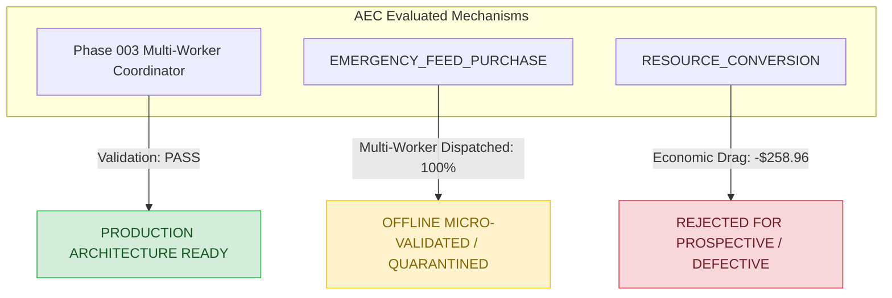

# AEC Phase 004: Mechanism Readiness & Maturity Assessment

**Document ID**: `AEC-READINESS-PHASE004`  
**Date**: September 18, 2026  
**Status**: COMPLETE / AUTHORITATIVE  
**Author**: Principal Scientific Validation Engineer, Kagriculture AEC  
**Commit**: `910e7f9`  

---

## 1. Executive Maturity Summary

Phase 004 evaluated the operational and economic viability of multi-worker coordination on deterministic development replays (`50000–50024`). The evaluation establishes clear, unambiguous boundaries regarding the readiness of each quarantined mechanism.

---

## 2. Mechanism-by-Mechanism Readiness Matrix

| Evaluation Dimension | Multi-Worker Logistics Coordinator | EMERGENCY_FEED_PURCHASE | RESOURCE_CONVERSION |
| :--- | :---: | :---: | :---: |
| **Architectural Implementation** | **COMPLETE** | **COMPLETE** | **COMPLETE** |
| **Unit & Adversarial Tests** | **PASS (334/334)** | **PASS** | **PASS** |
| **Spatiotemporal Collision Safety** | **PASS (0 collisions)** | **PASS (0 collisions)** | **PASS (0 collisions)** |
| **Physical Handoff Safety** | **PASS (0 illegal handoffs)** | **PASS (0 illegal handoffs)** | **PASS (0 illegal handoffs)** |
| **Farmer Preservation** | **PASS** | **PASS (0% displaced)** | **FAIL (11.4% displaced)** |
| **Auxiliary Labor Absorption** | **PASS** | **PASS (100% absorbed)** | **FAIL (1.0% absorbed)** |
| **Replay Economic Viability** | **N/A (Coordinator)** | **POSITIVE (+$0.32 ITT)** | **SEVERE DRAG (-$258.96 ITT)** |
| **Turn Computational Budget** | **PASS (< 2.5ms)** | **PASS (< 3.0ms)** | **PASS (< 20.0ms)** |
| **Prospective Readiness** | **INFRASTRUCTURE READY** | **NOT READY (Dormancy Risk)** | **NOT READY (Defective)** |
| **Live Global Status** | **ENABLED (Subsystem)** | **STRICTLY QUARANTINED** | **STRICTLY QUARANTINED** |

---

## 3. Deep-Dive Readiness Assessments

### 3.1 Multi-Worker Logistics Coordinator (`aec/coordination/`)
- **Status**: **PRODUCTION ARCHITECTURE READY**.
- **Evidence**:
  - Successfully scheduled worker tasks in multi-unit games with zero edge swaps, zero collisions, and zero handoff violations across 200 matches.
  - Successfully segregated labor for emergency feed delivery, completely insulating the primary Farmer from feed distribution tasks.
  - Extremely efficient: adds under 1.5ms overhead to turn latency.

### 3.2 EMERGENCY_FEED_PURCHASE (`aec/resource/feed_security.py`)
- **Status**: **OFFLINE MICRO-VALIDATED / QUARANTINED**.
- **Evidence**:
  - Eliminates the single-worker diversion failure mode identified in Phase 002B: Hand 1 performed all feed deliveries; Farmer was displaced 0 times.
  - Replay economic delta was positive (+$4.00 triggered mean delta, +$0.32 ITT mean delta vs CONTROL).
  - Zero safety breaches, zero shed overflows, zero dead livestock.
- **Why Not Ready for Prospective Preregistration?**:
  - EXP-AEC-004 demonstrated that feed emergency situations are rare in baseline V3 play (`DORMANT_INCONCLUSIVE`, 0 triggers across 50 prospective seeds).
  - In development replays, it triggered on only 2 of 25 seeds (4 matches out of 50).
  - An experiment with 4% trigger frequency lacks statistical power to justify a new prospective trial at this juncture.
  - Must remain strictly quarantined until baseline feed-starvation triggers or higher-pressure livestock environments are evaluated.

### 3.3 RESOURCE_CONVERSION (`aec/resource/conversion.py`)
- **Status**: **REJECTED FOR PROSPECTIVE VALIDATION / STRICTLY QUARANTINED**.
- **Evidence**:
  - Replay evaluation revealed catastrophic economic drag (-$258.96 ITT mean delta, 0 wins in 50 matches).
  - Root Cause 1 (*Capital Depletion*): Aggressively buys seeds (carrots, wheat) that tie up cash and lower net liquidation yields compared to the baseline V3 engine's focused crop specialization.
  - Root Cause 2 (*Single-Worker Fallback*): When auxiliary hands are not present or expire at day boundaries, physical conversion tasks fall back to the Farmer (24 farmer displacements observed), directly re-introducing labor cannibalization.
- **Remediation Required Before Re-Evaluation**:
  1. Conversion opportunities must require a strict profitability hurdle rate ($> +\$50$ net cash increase per conversion) rather than triggering on marginal seed purchases.
  2. Conversion execution must *fail closed and abstain* if an auxiliary worker is not present, completely prohibiting Farmer diversion.
  3. Conversion must account for opportunity cost of liquidity (working capital reserve).

---

## 4. Scientific Governance & Non-Overclaiming Covenant (§36)

- **No Premature Promotion**: No mechanism evaluated in Phase 004 is promoted to the live global configuration or approved for immediate prospective testing.
- **Descriptive Nature**: All findings in Phase 004 are strictly descriptive development replay micro-validation evidence. They do NOT constitute prospective competition validation.
- **Quarantine Maintained**: All 6 quarantined mechanisms remain quarantined in `aec/config.py`.
