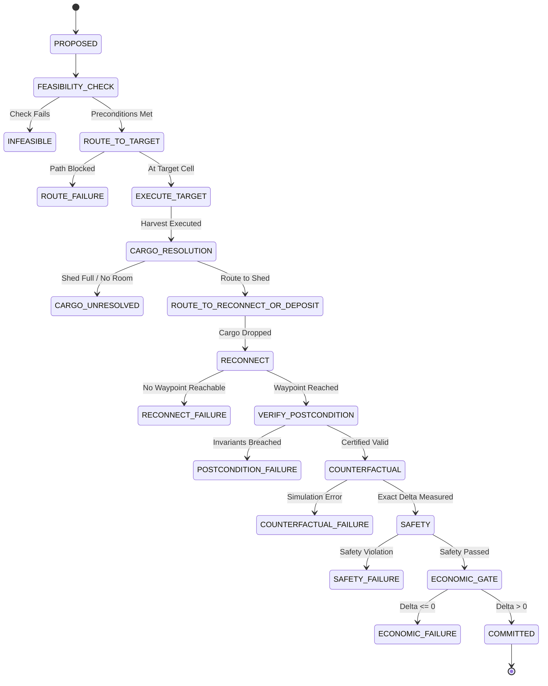

# SPDX-License-Identifier: MIT
# AEC Phase 006: Coupled Trajectory-Preserving Patch Engine & Dynamic Shadow Harvest
## Methodological & Architectural Design Specification

**Phase**: AEC Phase 006  
**Component**: `CoupledPatchEngine` (`aec/patches/coupled_patch_engine.py`), `CoupledPatch` (`aec/patches/coupled_patch.py`), and `HarvestCoupledPatchGenerator` (`aec/patches/harvest_patch.py`)  
**Evaluation Scope**: Development Seeds `50000–50024`  
**Date**: September 2026  
**Status**: DESIGN CERTIFIED  

---

### 1. The Necessity of the Coupled Patch Primitive

#### 1.1 Forensic Root Cause of Phase 005B Failure
In Phase 005B, an exhaustive ground-truth audit of the generic `LaborOpportunityCostEngine` against the exact C++ simulator (`kagsim`) uncovered a fatal structural deficiency in isolated, one-turn worker interventions:
- **Overall Sign Agreement**: Only **47.0%** (47/100).
- **Idle Worker Harvest Sign Agreement**: Only **24.0%** (6/25).
- **Mean Net Game Delta for Naive 1-Turn Harvests**: **-$7,452.32**, with severe catastrophic outliers dropping terminal rewards by up to -$57,743.00 (e.g. Seed 50005).

The forensic diagnosis confirmed that the failure was **not an economic valuation error**, but an **architectural trajectory-coupling failure**:
1. **Cargo Desynchronization**: A naive 1-turn patch forces an idle auxiliary hand to execute `HARVEST`. The worker acquires 2–4 crop units in their cargo backpack.
2. **Backbone Oblivion**: At step $t+1$, the frozen V3 agent loop resumes execution with zero awareness that the worker now carries cargo. V3's internal deterministic state machine expects an empty backpack and attempts to execute subsequent watering, seeding, or tool usage tasks.
3. **Execution Paralysis**: Because the worker is encumbered with unintended cargo, subsequent tool pickups fail, shed access states become illegal, or the worker stalls for multiple turns. The small immediate direct gain (+$60.00 to +$150.00) is completely dwarfed by tens of thousands of dollars in compound downstream disruption.

#### 1.2 The Architectural Principle: Bounded Coupled Trajectories
Therefore, the core insight of Phase 006 is:
> **An intervention in a complex multi-worker economy cannot be an isolated, single-turn action injection.**
>
> A viable intervention must be a **complete coupled patch (`CoupledPatch`)** that executes a bounded alternative trajectory, accomplishes its intended economic purpose, restores all physical and cargo invariants required by the baseline, and splices seamlessly back onto the baseline backbone.

$$\text{Full Trajectory} = \text{BASELINE PREFIX} + \text{COUPLED PATCH} + \text{RECONNECTION / BRIDGE} + \text{BASELINE SUFFIX}$$

---

### 2. Coupled Patch Architectural Model

The `CoupledPatch` architecture is implemented as a reusable, mechanism-agnostic primitive in `aec/patches/coupled_patch.py` and orchestrated by `CoupledPatchEngine` in `aec/patches/coupled_patch_engine.py`.

```text
Opportunity Detector
        ↓
CoupledPatchRequest
        ↓
Feasibility Verification
        ↓
Multi-Worker Space-Time Reservation
        ↓
Phase 1: Route to Target
        ↓
Phase 2: Execute Target Action (e.g. HARVEST)
        ↓
Phase 3: Route to Deposit / Shed
        ↓
Phase 4: Cargo Resolution (DROP + Optional SELL)
        ↓
Phase 5: Bridge Route to Reconnection Waypoint
        ↓
Trajectory Preservation Certification
        ↓
Exact Counterfactual Simulation
        ↓
Safety & Economic Gate
        ↓
Commit or Fail-Closed Abstain
```

#### 2.1 Core Typed Structures
The architecture defines formal typed dataclasses adhering strictly to Section 4–6 of the Phase 006 Directives:
- `CoupledPatch`: Formal representation of the coupled trajectory, actions, cargo transitions, and certificates.
- `CoupledPatchStep`: Discrete step representation recording relative offset, worker actions, positions, and market orders.
- `PatchPrecondition`: Explicit assumptions required for the patch to be safely applicable.
- `PatchPostcondition`: Guarantees delivered by the patch at its terminal waypoint.
- `PatchStateDelta`: Exact accounting of changes to cash, worker cargo, shed inventory, tiles, and positions.
- `TrajectoryPreservationCertificate`: Authoritative verification that baseline suffix assumptions remain 100% preserved.
- `CoupledPatchRequest` & `CoupledPatchResult`: Structured compilation inputs and outputs.

---

### 3. Precondition / Postcondition & Preservation Contract

#### 3.1 Patch Preconditions (`PatchPrecondition`)
Every coupled patch explicitly records:
- `worker_positions`: Required starting coordinates for assigned workers.
- `worker_cargo`: Existing inventory in worker backpacks prior to patch.
- `shed_inventory` & `shed_capacity_remaining`: Available shed volume to accept harvested yield without overflow.
- `required_tiles`: Physical state of target tiles (e.g. `kind == "PLANT"`, maturity age $\ge$ first yield day, yield units $> 0$).
- `earliest_start_step` & `latest_start_step`: Valid temporal execution window.

#### 3.2 Patch Postconditions (`PatchPostcondition`)
Every coupled patch guarantees upon completion:
- `worker_positions`: Worker is positioned exactly at the designated reconnection waypoint $P_{\text{target}}$.
- `worker_cargo`: Worker cargo is strictly empty (`{}`), ensuring zero unexpected backpack encumbrance.
- `shed_inventory`: Harvested resources are securely deposited in the farm shed.
- `delivered_resources`: Resource quantities delivered.
- `cash_delta`: Direct cash revenue realized from immediate market sale.
- `baseline_reconnect_step`: Absolute simulation step where the baseline suffix resumes.
- `baseline_executable`: The subsequent baseline command is physically and operationally legal.

#### 3.3 Trajectory Preservation Contract (`TrajectoryPreservationCertificate`)
The certificate validates nine non-negotiable invariants before any patch can be committed:
1. **Worker Position Alignment**: Worker is at the exact waypoint expected by the baseline continuation.
2. **Cargo State Consistency**: The baseline does not assume cargo is absent when the worker is carrying items.
3. **Worker Task State Compatibility**: The worker is left in an operational state fully compatible with subsequent tasks.
4. **Shed / Inventory Accountability**: All newly deposited products are accurately accounted for.
5. **Resource Input Accountability**: Consumed inputs are reconciled.
6. **Timing Feasibility**: Timing shift $\Delta t \le 4$ steps, and all downstream deadlines remain intact.
7. **Prerequisite Integrity**: No downstream biological dependency is silently broken.
8. **Terminal Feasibility**: Execution does not push realization past episode termination ($t \le 718$).
9. **Multi-Worker Coordination**: No vertex collisions, edge swaps, or shed access conflicts with peer workers.

---

### 4. Coupled Patch Lifecycle State Machine

The patch generator executes an explicit 12-state finite state machine:



Every failure branch terminates in a strict fail-closed state (`INFEASIBLE`, `ROUTE_FAILURE`, `CARGO_UNRESOLVED`, `DEPENDENCY_FAILURE`, `RECONNECT_FAILURE`, `POSTCONDITION_FAILURE`, `TERMINAL_RISK`, `SAFETY_FAILURE`, `ECONOMIC_FAILURE`), preventing invalid action injection.

---

### 5. Harvest Consumer Implementations

Phase 006 implements two distinct operational consumers built upon the reusable `CoupledPatch` primitive:

#### 5.1 Dynamic Shadow Harvest (Mid-Game Adaptive)
- **Trigger**: Worker is idle (`PASS` / `WAIT`) or economically movable, with a mature crop within reach ($D \le 3$).
- **Multi-Phase Execution**:
  1. `NAVIGATE_TO_TARGET`: Shortest collision-free path from current cell to crop cell.
  2. `HARVEST`: Yield is added to worker cargo backpack; crop tile transitions to empty.
  3. `NAVIGATE_TO_SHED`: Pathfinding to closest shed access cell in `SHED_TILES` (`[(4,4), (5,4), (4,5), (5,5)]` for 10x10).
  4. `DROP`: Unloads all cargo into shed inventory; backpack returns to `{}`.
  5. `RECONNECT`: Navigates from shed to candidate waypoint along baseline continuation; splices baseline suffix.
- **Economic Gating**: Screened first by `LaborOpportunityCostEngine` (calculating displacement cost), then validated by exact forward rollout counterfactual. Must have $\Delta_{\text{exact}} > 0$.

#### 5.2 Terminal Harvest Sweep (Late-Game Realization)
- **Trigger**: Step $s \ge 650$ (Day $\ge 27$) where mature crops remain unharvested.
- **Terminal Optimization**:
  - Because episode concludes at step 718, a full return bridge to baseline continuation is not required if the game terminates.
  - **Terminal Constraint**: Harvest, navigation to shed, and `DROP` + `SELL` must strictly complete at or before step 718 ($s_{\text{deposit}} \le 718$).
  - If a harvest candidate cannot be deposited and liquidated before step 718, it is rejected with `TERMINAL_RISK` because unsold products in the shed or worker backpack contribute $0.00 to the official game reward.

---

### 6. Summary of Architectural Guarantees

| Design Requirement | Phase 005B Naive Patch | Phase 006 CoupledPatch | Architectural Benefit |
| :--- | :--- | :--- | :--- |
| **Patch Scope** | Single isolated turn ($t$) | Bounded multi-step trajectory ($t \dots t+K$) | Complete operational closure |
| **Cargo State** | Leaves cargo in backpack | Drops cargo in shed (`DROP`) | Zero backpack desynchronization |
| **Worker Position** | Diverges from baseline | Bridges back to baseline waypoint | Seamless baseline suffix continuation |
| **Multi-Worker Safety** | Uncoordinated | Space-time reservation table | Zero collisions or edge swaps |
| **Economic Gate** | Local proxy estimate only | Exact forward simulation rollout | Guaranteed $\Delta_{\text{terminal}} > 0$ |
| **Terminal Economics** | Assumes biological potential | Realizes liquid cash before step 719 | Exact simulator parity |

The `CoupledPatch` engine provides the foundational trajectory-preserving mechanism for all future AEC tactical interventions.
