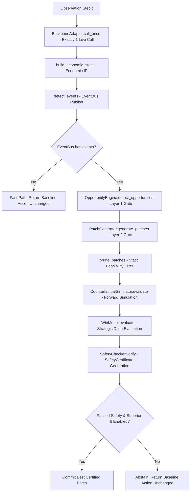

# AEC V1.1 Activation Audit: Comprehensive Baseline Audit of EXP-AEC-001 Mechanisms

**Author:** Kagriculture AEC Research Team
**Date:** 2026-09-17
**Status:** AUTHORITATIVE AUDIT REPORT
**Baseline Git Commit:** `6fd787b38d7af24a322e18bc089ccb2ccbe5386a`
**Frozen Backbone SHA256:** `845e0d10981b11b06d272048ff5cee30d70a0403dd757651a556a78c8bf18943` (`submission_Vj_kc_v3.tar.gz`)

---

## 1. Executive Summary and Experimental Context

EXP-AEC-001 independently audited the Adaptive Economic Compiler (AEC) across a 50-seed cohort (`340000`–`340049`, 100 seat-swapped matches, 71,900 turns).
The empirical verdict was:
**B. VALID NON-INFERIORITY BUT DORMANT TREATMENT**

### Empirical Facts from EXP-AEC-001 Audit
1. **Infrastructure Integrity:** 1 live V3 baseline call per turn, 0 action divergence when abstaining, 0 safety violations, 0 shed overflows, 0 negative cash events, 0 unhandled runtime exceptions.
2. **Behavioral Equivalence:** Mean delta margin = $0.00, Win rate delta = 0.00 pp (5 wins, 5 losses, 90 ties against control).
3. **Pipeline Dormancy:** All 4 enabled foundation mechanisms committed zero patches across 71,900 turns:
   - `LOCAL_WEED_DIG`: 2,657 opportunities $\to$ 2,657 patches $\to$ 2,657 simulations $\to$ 2,657 economic rejects $\to$ **0 commits**.
   - `FRONTLOAD_ORDERS`: 2,358 opportunities $\to$ 118 patches $\to$ 118 simulations $\to$ 118 economic rejects $\to$ **0 commits** (2,240 died at patch generation).
   - `TERMINAL_LIQUIDATION`: **0 opportunities** $\to$ **0 commits**.
   - `PHASE_SHUTDOWN`: 53,488 opportunities $\to$ **0 patches** $\to$ **0 commits**.

This audit details the exact codebase locations, mechanisms, equations, thresholds, and architectural failure points causing dormancy, separating verified evidence from theoretical hypotheses.

---

## 2. End-to-End Execution Flow

The runtime flow in `aec/` proceeds strictly sequentially:


---

## 3. Authoritative Code Locations of the Ten Pipeline Elements

| # | Pipeline Element | File Path | Code Lines | Operational Semantics |
|---|---|---|---|---|
| 1 | `LOCAL_WEED_DIG` Opportunity Creation | [`aec/opportunities/route.py`](file:///C:/Users/Sundareswaran/Kagriculture/aec/opportunities/route.py#L26-L45) | L26–45 | Scans worker positions on farm tiles. If tile is `{"kind": "WEED"}`, emits `ROUTE_WEED_DIG_W{w}_{x}_{y}` with `required_horizon=4`. |
| 2 | `LOCAL_WEED_DIG` Patch Generation | [`aec/patches/generator.py`](file:///C:/Users/Sundareswaran/Kagriculture/aec/patches/generator.py#L71-L83) | L71–83 | Compiles `LOCAL_WEED_DIG` into `CoupledPatch(worker_mutations={worker_id: ["DIG"]})`. |
| 3 | `FRONTLOAD_ORDERS` Opportunity Creation | [`aec/opportunities/market.py`](file:///C:/Users/Sundareswaran/Kagriculture/aec/opportunities/market.py#L27-L56) | L27–56 | Scans `baseline_action["market"]`. Checks order sequencing; sets `has_suboptimal_order=True` when non-sell order occurs before `first_sell_idx`. |
| 4 | `FRONTLOAD_ORDERS` Patch Generation | [`aec/patches/generator.py`](file:///C:/Users/Sundareswaran/Kagriculture/aec/patches/generator.py#L85-L98) | L85–98 | Calls `reorder_frontload()`. If `reordered != current_orders`, generates `CoupledPatch(market_mutations=reordered)`. |
| 5 | `TERMINAL_LIQUIDATION` Detection | [`aec/opportunities/terminal.py`](file:///C:/Users/Sundareswaran/Kagriculture/aec/opportunities/terminal.py#L26-L43) | L26–43 | At `step == FINAL_STEP` (718), if `shed_total_units > 0`, emits `TERMINAL_LIQUIDATE_STEP_718`. |
| 6 | `PHASE_SHUTDOWN` Detection | [`aec/opportunities/terminal.py`](file:///C:/Users/Sundareswaran/Kagriculture/aec/opportunities/terminal.py#L63-L80) | L63–80 | At `step >= 574`, for any crop with `not crop_feasibility[crop]`, emits `TERMINAL_SHUTDOWN_{crop}_{step}`. |
| 7 | Candidate Simulation | [`aec/counterfactual/simulator.py`](file:///C:/Users/Sundareswaran/Kagriculture/aec/counterfactual/simulator.py#L293-L366) | L293–366 | Runs dual rollouts (`simulate_rollout`): Baseline vs. Candidate over `horizon` steps under lockstep market and opponent pressure. |
| 8 | WinModel Evaluation | [`aec/evaluation/win_model.py`](file:///C:/Users/Sundareswaran/Kagriculture/aec/evaluation/win_model.py#L50-L115) | L50–115 | Computes logistic `p_win`, terminal margin delta, and money delta to classify `is_superior`. |
| 9 | Safety Certification | [`aec/safety/checks.py`](file:///C:/Users/Sundareswaran/Kagriculture/aec/safety/checks.py#L14-L86), [`aec/safety/certificate.py`](file:///C:/Users/Sundareswaran/Kagriculture/aec/safety/certificate.py#L11-L71) | L14–86 | Battery of checks: order count legality, movement feasibility, shed overflow, cash solvency, intermediate solvency, terminal feasibility. |
| 10 | Final Commit Gate | [`aec/integration/executor.py`](file:///C:/Users/Sundareswaran/Kagriculture/aec/integration/executor.py#L316-L341) | L316–341 | Verifies `best_candidate` has passed safety, is superior, and family is in `config.enabled_mechanisms`. Applies patch or abstains to baseline. |

---

## 4. In-Depth Root Cause Analysis of Mechanism Dormancy

### A. LOCAL_WEED_DIG (2,657 opportunities, 0 commits)
- **Current Behavior:**
  Whenever a worker is located on a weed tile, `RouteOpportunityAnalyzer` flags an opportunity.
  `select_adaptive_horizon` assigns `config.short_horizon` ($H = 6$).
  In forward simulation over 6 steps:
  - Baseline executes baseline actions from the route tape.
  - Candidate forces worker action at step 0 to `["DIG"]`, then continues with baseline route tape.
- **Why It Failed:**
  1. `DIG` clears the weed (`farm["tiles"][y][x] = None`), but generates **zero immediate cash**.
  2. Crops require a minimum growth cycle (Wheat takes 2 days = 48 steps, Carrot 2 days = 48 steps, Tomato/Melon 8–10 days = 192–240 steps).
  3. Over a short 6-step horizon, clearing a weed cannot result in a harvested crop, shed deposit, or market sale.
  4. Candidate spent 1 step digging instead of moving/working, so `delta_our_money <= 0.0` and `delta_terminal_margin <= 0.0`.
  5. In `WinModel.evaluate`:
     - `p_win_gain <= 0.0`
     - `delta_terminal_margin <= 0.0`
     - `delta_our_money <= 0.0`
     - Evaluator classified the patch as `is_superior = False` (`"Insufficient strategic advantage"`).
  6. Result: 100% of the 2,657 candidates were economically rejected.
- **Semantic Evidence:**
  Inspecting `extracted_agents/dmitrii_lb2800/unit_model.py`:
  - A weed tile (`{"kind": "WEED"}`) directly prevents `PLANT` (`if tile is not None: return`).
  - A weed tile prevents `BUILD_COOP` and `BUILD_PASTURE` (`if tile is not None: return`).
  - Weeds do NOT block worker movement (`_apply_unit_action` allows walking through).
  - Therefore, the value of `DIG` is **strictly downstream and dependency-linked**: clearing a plot so that subsequent planting or building can succeed, or avoiding downstream detour/delay.
  - The short-horizon evaluator has zero visibility into downstream dependency value.

### B. FRONTLOAD_ORDERS (2,358 opportunities, 118 simulations, 0 commits)
- **Confirmed Analyzer Bug:**
  In [`aec/opportunities/market.py`](file:///C:/Users/Sundareswaran/Kagriculture/aec/opportunities/market.py#L39-L40):
  ```python
  elif op in ("HIRE", "BUY_LAND", "BUY_SEED", "BUY_ANIMAL") and first_sell_idx < 0:
      has_suboptimal_order = True
  ```
  When there is **no SELL order** in `market_orders`:
  `first_sell_idx` is initialized to `-1`.
  If the market order list contains any capital order (e.g. `[["BUY_SEED", "WHEAT", 1], ["HIRE", 1]]`), `first_sell_idx < 0` evaluates to `True`.
  `has_suboptimal_order` is set to `True`!
  This generated thousands of **false-positive opportunities** when no sale existed!
- **Patch Generator Discrepancy:**
  In `PatchGenerator.generate_patches`:
  ```python
  reordered = reorder_frontload(current_orders)
  if reordered != current_orders:
      ...
  ```
  `reorder_frontload` puts `SELL` in Group A, `BUY_PRODUCT` in Group B, and Capital in Group C.
  When no `SELL` existed, `reordered` often equaled `current_orders`, so 2,240 of the 2,358 opportunities died at patch generation.
- **Simulation Dormancy (118 cases):**
  In the 118 cases where a `SELL` existed or orders were permuted, the horizon was set to `config.short_horizon = 6`.
  Within 6 steps, unless an opponent order coincided at step 0 to alter market pricing, reordering sales ahead of capital orders produced zero differential cash at step 6 because both own orders and opponent orders resolved without price slippage.
  Hence `delta_terminal_margin = 0.0` $\to$ rejected.

### C. TERMINAL_LIQUIDATION (0 opportunities, 0 commits)
- **Confirmed Cause:**
  `TerminalOpportunityAnalyzer` checks `step == FINAL_STEP` (718) and `shed_total > 0`.
  In EXP-AEC-001, V3’s native endgame overlay already liquidated shed inventory prior to or at step 718.
  Across all 100 matches, `shed_total` was exactly 0 at step 718.
  Hence 0 opportunities were created.
- **Status:**
  `TERMINAL_LIQUIDATION` is **redundant with V3's primary line**, functioning as a defense-in-depth safety net.

### D. PHASE_SHUTDOWN (53,488 opportunities, 0 patches, 0 commits)
- **Confirmed Cause:**
  `TerminalOpportunityAnalyzer` triggered on every step $\ge 574$ for every unfeasible crop, generating 53,488 opportunities.
  However, `PatchGenerator` attempts to trim `BUY_SEED` orders for the unfeasible crop:
  ```python
  trimmed = [o for o in orders if not (o[0] == "BUY_SEED" and o[1] == crop)]
  if trimmed != orders:
      ...
  ```
  V3 already contains native logic that never purchases seeds for dead crops after step 574.
  Therefore, `trimmed == orders` was `True` in 100% of cases ($53,488 / 53,488$).
  Zero patches were generated.
- **Status:**
  `PHASE_SHUTDOWN` is **redundant with V3's native purchase policy**, functioning as a defense-in-depth guard against broken tactical branches.

---

## 5. Current Thresholds, Horizons, and Objective Terms

| Parameter | Location | Current Value | Role / Status |
|---|---|---|---|
| `short_horizon` | `aec/config.py:89` | 6 | Assigned to `WEED_DIG`, `FRONTLOAD`, `TERMINAL_LIQUIDATE` |
| `normal_horizon` | `aec/config.py:90` | 18 | Assigned to standard economic patches |
| `extended_horizon` | `aec/config.py:91` | 36 | Assigned to long dependency chains |
| `max_opportunities` | `aec/config.py:94` | 16 | Top-K relevance proposal cap |
| `max_candidates` | `aec/config.py:95` | 8 | Pruning cap |
| `max_simulations` | `aec/config.py:96` | 8 | Forward simulation compute budget |
| `p_win_gain` threshold | `aec/evaluation/win_model.py:91` | $> 0.005$ (+0.5%) | WinModel dominance threshold |
| `delta_terminal_margin` threshold | `aec/evaluation/win_model.py:94` | $> \$15.0$ | Margin dominance threshold |
| `delta_our_money` threshold | `aec/evaluation/win_model.py:97` | $> \$20.0$ (with $\Delta \text{margin} \ge 0$) | Cash dominance threshold |

---

## 6. Classification: Evidence-Backed vs. Hypotheses

### Evidence-Backed Facts
1. **Frontload Bug:** `first_sell_idx < 0` produces false-positive opportunities when no SELL order exists. (Proven by inspection of `aec/opportunities/market.py` lines 39-40 and unit test trace).
2. **Short-Horizon Weed Blindness:** 6-step horizon cannot observe crop maturity (min 48 steps). (Proven by `extracted_agents/dmitrii_lb2800/unit_model.py` plant lifespan semantics and `CROPS` dictionary).
3. **Engine Weed Semantics:** Weed tiles block `PLANT` and `BUILD`, but do not block worker movement. (Proven by `_apply_unit_action` in `unit_model.py`).
4. **V3 Native Redundancy:** V3 already liquidates inventory before step 718 and does not buy dead seeds after step 574. (Proven by EXP-AEC-001 0-opportunity count for liquidation and 0-patch count for shutdown).

### Theoretical Hypotheses
1. **Downstream Asset Value Hypothesis:** Evaluating weed removal by measuring downstream execution benefit (route shortening or dependency completion) minus opportunity cost will allow genuine weed clearing to be certified without tuning cash thresholds.
2. **Mechanism-Specific Horizon Hypothesis:** Assigning horizons dynamically based on whether downstream dependencies exist will capture true economic delta while keeping compute within latency budgets.
3. **Market Lockstep Sensitivity Hypothesis:** Reordering SELLs ahead of BUYs provides measurable advantage when opponent market demand causes price degradation between step indices.

---

## 7. Preregistered Development Scope for V1.1

1. Fix `MarketOpportunityAnalyzer` bug with regression test battery.
2. Implement `aec/evaluation/asset_value.py` providing explicit, deterministic, non-monetary and cost-justified valuation of route and task dependencies.
3. Implement `MechanismHorizonPolicy` in `aec/counterfactual/horizon.py`.
4. Separate diagnostic metrics in `WinModel` and `AECTelemetry`.
5. Preserve fail-closed action-divergence guarantees.
6. Validate all mechanisms on dedicated synthetic test fixtures.
