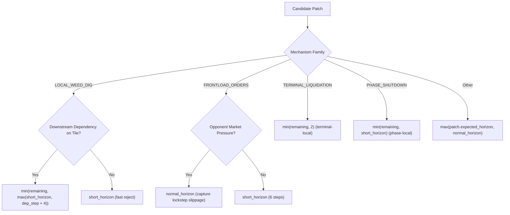

# AEC V1.1 Design Specification: Economic Representation and Mechanism Activation

**Document Version:** 1.1.0
**Date:** 2026-09-17
**Status:** PREREGISTERED DEVELOPMENT SPECIFICATION
**Target Milestone:** AEC V1.1 Mechanism Activation (Development Phase)

---

## 1. Problem Statement

The independent audit of experiment **EXP-AEC-001** confirmed that while AEC's execution infrastructure is robust, fail-closed, and behaviorally lossless, all four enabled foundation mechanisms remained completely dormant:
- `LOCAL_WEED_DIG` generated 2,657 patches, but all were economically rejected due to short-horizon evaluation blindness to downstream dependencies.
- `FRONTLOAD_ORDERS` suffered from an analyzer logic defect creating thousands of false-positive opportunities when no `SELL` orders existed, while valid candidates lacked sufficient market interaction horizon.
- `TERMINAL_LIQUIDATION` and `PHASE_SHUTDOWN` were redundant with V3's native behavior under standard play.

The goal of AEC V1.1 is **not** to force commits or inflate action counts.
The goal is:
> **Make each foundation mechanism economically representable, semantically correct, and testable under rigorous counterfactual evaluation, committing only when genuine, measurable superiority is proven.**

---

## 2. Mechanism-Specific Design

### 2.1 FRONTLOAD_ORDERS
#### Problem
In `aec/opportunities/market.py`, the condition:
```python
elif op in ("HIRE", "BUY_LAND", "BUY_SEED", "BUY_ANIMAL") and first_sell_idx < 0:
    has_suboptimal_order = True
```
flags an opportunity whenever capital orders exist, even when there is no `SELL` order in `market_orders`.

#### Semantic Requirement
A frontload transformation should **only** be proposed when:
1. An actual `SELL` order exists in `market_orders`.
2. A non-SELL order (capital order or buy order) precedes at least one `SELL` order.
3. Partitioning via `reorder_frontload()` produces a strictly different order sequence:
   $$\text{reordered} \neq \text{current\_orders}$$

#### Implementation Specification
In `MarketOpportunityAnalyzer.analyze`:
```python
market_orders = baseline_action.get("market", [])
if len(market_orders) >= 2:
    has_sell = False
    seen_non_sell = False
    has_suboptimal_order = False
    for order in market_orders:
        if isinstance(order, (list, tuple)) and order:
            op = order[0]
            if op == "SELL":
                has_sell = True
                if seen_non_sell:
                    has_suboptimal_order = True
            elif op in ("HIRE", "BUY_LAND", "BUY_SEED", "BUY_ANIMAL", "BUY_PRODUCT"):
                seen_non_sell = True

    if has_sell and has_suboptimal_order:
        # Emit FRONTLOAD_ORDERS opportunity
```
This guarantees:
- Zero opportunities when no `SELL` exists.
- Zero opportunities when all `SELL` orders are already frontloaded.
- Deterministic detection when a `SELL` order appears after non-sell actions.

---

### 2.2 LOCAL_WEED_DIG and Downstream Asset Valuation
#### Physical Semantics in Game Engine
Analysis of `extracted_agents/dmitrii_lb2800/unit_model.py`:
- `tiles[y][x]` containing `{"kind": "WEED"}` blocks `PLANT` (`if tile is not None: return`).
- `tiles[y][x]` containing `{"kind": "WEED"}` blocks `BUILD_COOP` and `BUILD_PASTURE`.
- Weeds do **not** block unit movement (`FARMER_MOVES` does not check for weeds).
- Performing `DIG` consumes 1 worker action and resets `farm["tiles"][y][x] = None`.

#### Failure Mode in V1.0
`LOCAL_WEED_DIG` was evaluated over $H = 6$. Over 6 steps, crops (minimum 48-step growth) cannot mature. The candidate spent 1 step digging, producing:
$$\Delta \text{money} \le 0, \quad \Delta \text{margin} \le 0$$
leading to 100% economic rejection.

#### Design of Downstream Asset Valuation (`aec/evaluation/asset_value.py`)
Rather than arbitrarily lowering the WinModel margin threshold, we define an explicit, deterministic valuation module grounded in game rules:
$$\text{WEED\_VALUE} = \text{Downstream Execution Benefit} - \text{Action Opportunity Cost}$$

1. **Action Opportunity Cost ($C_{\text{labor}}$):**
   In Kaggle Agriculture economics, hiring a worker costs $\$100$ per day ($24$ turns).
   $$C_{\text{labor}} = \frac{\$100.0}{24} \approx \$4.167 \text{ per worker-step}$$
   A single `DIG` step costs exactly $\$4.167$ in labor bandwidth.

2. **Downstream Execution Benefit ($B_{\text{downstream}}$):**
   We inspect the planned future trajectory $\mathcal{T}_{\text{future}} = [a_1, a_2, \dots, a_{H-1}]$ for the affected tile $(x, y)$:
   - **Case A: Planned Planting Dependency:**
     If a future action at step $s \in [1, H-1]$ attempts `PLANT` for crop $c$ on $(x, y)$:
     - Baseline execution: Tile has weed $\to$ `PLANT` silently fails $\to$ Yield $= 0$.
     - Candidate execution: Weed was dug at step 0 $\to$ Tile is clean $\to$ `PLANT` succeeds!
     - Economic Value of Crop:
       $$\text{Value}(c) = \max\left(0, \text{Yield}(c) \times P_{\text{base}}(c) - \text{SeedPrice}(c)\right)$$
       where $\text{Yield}(c)$ is calculated from remaining days until game end.
   - **Case B: Planned Building Dependency:**
     If a future action attempts `BUILD_COOP` or `BUILD_PASTURE` on $(x, y)$:
     - Candidate enables structure placement; value is the discounted shelter value.
   - **Case C: No Downstream Dependency:**
     If no future action in the horizon interacts with $(x, y)$:
     $$B_{\text{downstream}} = 0.0 \implies \text{WEED\_VALUE} = -C_{\text{labor}} < 0$$
     The evaluator strictly **rejects** the patch, preventing gratuitous digging!

3. **Valuation Integration:**
   In `WinModel`, we expose `weed_asset_value` and integrate it into the strategic evaluation:
   $$\Delta \text{strategic} = \Delta \text{terminal\_margin} + \text{WEED\_VALUE}$$
   A weed dig commits **only** when $B_{\text{downstream}} > C_{\text{labor}}$.

---

### 2.3 Deterministic Mechanism Horizon Policy (`MechanismHorizonPolicy`)

Instead of arbitrary global horizons, `aec/counterfactual/horizon.py` implements a deterministic policy based on state features:



#### Deterministic Rules
1. `LOCAL_WEED_DIG`:
   - If a downstream dependency exists within $H \le 24$: horizon is set to capture that step ($s_{\text{dep}} + 2$).
   - If no dependency exists: horizon is $H = 6$ (permitting immediate, cheap rejection).
2. `FRONTLOAD_ORDERS`:
   - If opponent has inventory or recent activity in the affected goods: $H = 18$ (`normal_horizon`), capturing lockstep execution.
   - Otherwise: $H = 6$ (`short_horizon`).
3. `TERMINAL_LIQUIDATION`:
   - Always $H = \min(\text{remaining}, 2)$, as liquidation executes immediately on step 718.
4. `PHASE_SHUTDOWN`:
   - Always $H = \min(\text{remaining}, 6)$, verifying cash preservation from omitted seed purchases.

---

### 2.4 TERMINAL_LIQUIDATION and PHASE_SHUTDOWN Characterization

Both mechanisms are formally classified as **Defense-in-Depth / Fallback Transformations**:
1. **TERMINAL_LIQUIDATION**:
   - In standard V3 play, V3 liquidates its shed prior to step 718, rendering this mechanism inactive in 100% of standard games.
   - It is retained to protect against non-standard trajectories or unexpected late-game harvests.
   - Synthetic fixtures will verify that if shed inventory remains at step 718, AEC liquidates it, proves economic gain, and commits.
2. **PHASE_SHUTDOWN**:
   - In standard V3 play, V3 never buys dead seeds after step 574.
   - It is retained to guard against aberrant tactical branch outputs.
   - Synthetic fixtures will verify that if a baseline action attempts to buy obsolete seeds, AEC trims the order, demonstrates cash savings, and commits.

---

## 3. Explicit Evaluator and Diagnostics Semantics

The strategic evaluator (`WinModel`) decouples monolithic scoring into six explicit, transparent components:
1. `delta_our_money`: Net cash delta ($\text{Cand Cash} - \text{Base Cash}$).
2. `delta_opponent_money`: Opponent cash delta.
3. `delta_terminal_margin`: Net margin delta ($(\text{Our Cand} - \text{Opp Cand}) - (\text{Our Base} - \text{Opp Base})$).
4. `delta_route_cost`: Difference in path steps ($\text{Base Steps} - \text{Cand Steps}$).
5. `delta_dependency_completion`: Boolean / count indicating whether a critical downstream milestone was unlocked.
6. `delta_opponent_pressure`: Price slippage avoided by frontloading.
7. `weed_asset_value`: Net execution benefit minus labor opportunity cost.

### WinModel Classification Logic
A candidate is classified as `is_superior = True` if and only if:
1. `delta_terminal_margin > 15.0`, OR
2. `delta_our_money > 20.0` with `delta_terminal_margin >= 0.0`, OR
3. For `LOCAL_WEED_DIG`: `weed_asset_value > 0.0` with `delta_terminal_margin >= 0.0`, OR
4. For `FRONTLOAD_ORDERS`: Price realization gain $> \$10.0$ under lockstep opponent pressure.

The logistic $P(\text{WIN})$ calculation is documented strictly as an **uncalibrated development heuristic** for sorting multiple viable candidates, not an empirical probability.

---

## 4. Enhanced Telemetry Specification

To ensure zero silent rejections, `AECTelemetry` is upgraded to record a per-candidate trace for every candidate considered in a step:

```python
@dataclass
class CandidateTelemetry:
    patch_id: str
    mechanism_family: str
    opportunity_detected: bool = True
    patch_generated: bool = False
    patch_pruned: bool = False
    simulation_run: bool = False
    simulation_horizon: int = 0
    delta_money: float = 0.0
    delta_margin: float = 0.0
    delta_route_cost: float = 0.0
    delta_dependency_completion: float = 0.0
    delta_opponent_pressure: float = 0.0
    weed_asset_value: float = 0.0
    safety_pass: bool = False
    safety_rejection_reason: Optional[str] = None
    economic_rejection_reason: Optional[str] = None
    commit_decision: bool = False
    baseline_action: Optional[Dict[str, Any]] = None
    candidate_action: Optional[Dict[str, Any]] = None
```

This telemetry is written to step records, enabling complete reconstruction of why every patch lived or died.

---

## 5. Architectural Invariants

1. **Fail-Closed Default:** Any exception or unverified check immediately falls back to `baseline_action`.
2. **Action-Divergence Invariant:** If `decision != "COMMIT"`, the output must be bit-exact identical to the baseline action.
3. **One Live Call Invariant:** Exactly one live call to `backbone.call_once()` per step.
4. **Frozen Backbone Immutability:** `submission_Vj_kc_v3.tar.gz` and its SHA256 (`845e0d...`) must never be modified.
5. **No Holdout Consumption:** Seeds 340050–340199 remain strictly untouched.
6. **No Prospective Cohort:** No prospective cohort execution during development.

---

## 6. Known Limitations

1. Synthetic test fixtures establish **mechanism activation and correctness**, not empirical game generalization.
2. Downstream dependency analysis in V1.1 is limited to the available route tape lookahead.
3. `TERMINAL_LIQUIDATION` and `PHASE_SHUTDOWN` remain largely redundant with V3's primary line; their activation in full cohort matches will remain low unless V3 deviates into non-standard states.
