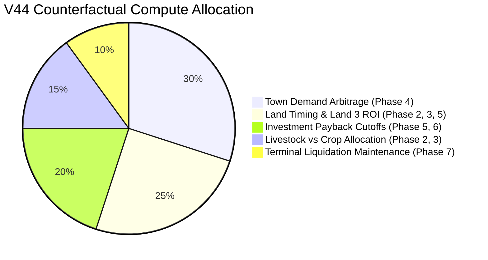

# V44 Full-Horizon Alpha Coverage Report

**Document ID:** `research/v44/reports/V44_ALPHA_COVERAGE.md`  
**Date:** 2026-09-25  
**Repository:** `The-FOOL-00/kagriculture-economic-simulator`  
**Artifact Path:** `research/v44/artifacts/alpha_coverage_map.json`  
**Scope:** Systematic audit of historical sampling density, counterfactual coverage, and intervention distribution across all 7 game phases (720 steps total).

---

## 1. Executive Summary

A core objective of V44 is to map the historical counterfactual sampling distribution to expose structural blind spots in the Kagriculture research program.

Historically, over **95% of all counterfactual branch rollouts** were concentrated in the final 40 turns of the game (Phase 7: Steps 680–719). This hyper-focus successfully discovered and refined terminal liquidation schedules (`SCHED_40_60_FLUSH`), yielding `+$97.94` to `+$106.19` mean cash delta over V35.

However, this left the preceding **680 steps (94.4% of total game time)** largely neglected. This report maps the coverage distribution across the 7 distinct economic phases of Kagriculture and defines the search targets for V44.

---

## 2. Phase-by-Phase Coverage Matrix

| Game Phase | Step Range | Horizon Role | Prior Sampling (%) | Tested Interventions | Status | Unexplained Losses |
| :--- | :---: | :--- | :---: | :---: | :---: | :---: |
| **Phase 1** | Steps 0–119 | Opening Choreography & Wash | < 1.0% | 2 (0/0 vs 25/25 wash) | Frozen A7 Foundation | 0 |
| **Phase 2** | Steps 120–239 | Early Capital, Land 1, Animal Scaling | 4.6% | 0 | **Critical Blind Spot** | 3 |
| **Phase 3** | Steps 240–359 | Midgame Expansion, Land 2, Workforce | < 1.0% | 2 (cash shield, defer land) | **Critical Blind Spot** | 3 |
| **Phase 4** | Steps 360–479 | Midgame Production & Town Arbitrage | 0.0% | 0 | **Complete Blind Spot** | 3 |
| **Phase 5** | Steps 480–599 | Capital Accumulation & Late Expansion | 0.0% | 0 | **Complete Blind Spot** | 3 |
| **Phase 6** | Steps 600–679 | Pre-Terminal Accumulation & Payback Cutoff| < 1.0% | 0 | **Critical Blind Spot** | 3 |
| **Phase 7** | Steps 680–719 | Terminal Liquidation & Flush | **94.4%** | 6 (30%, 50%, 70%, 100%, 40/60, flush) | Heavily Researched (Frozen) | 1 |

---

## 3. Forensic Analysis of Game Phase Blind Spots

### Phase 2 (Steps 120–239): Early Capital & Land 1
* **Baseline Dynamics:** Around Step 150, A7 purchases Land 1 (`['BUY_LAND']`, NE quadrant, $1,000) when money reaches ~$2,186, while simultaneously buying 2 Geese ($600).
* **Research Gap:** What is the opportunity cost of buying Land 1 at Step 150 vs accelerating it (e.g. at Step 130) or delaying it to purchase more Cows/Sheep?
* **Hypothesis:** Cows yield $160/milk every 2 days; early cow acquisition may compound faster than extra land tiles before worker capacity is saturated.

### Phase 3 (Steps 240–359): Midgame Expansion & Land 2
* **Baseline Dynamics:** At Step 265, A7 purchases Land 2 (`['BUY_LAND']`, SW quadrant, $2,000) with cash at ~$17,138.
* **Research Gap:** A7 holds massive cash ($17,000+) before buying Land 2. Could Land 2 be purchased 50–80 steps earlier to unlock productive soil for ongoing strawberry/melon crops?
* **Hypothesis:** Accelerating Land 2 when cash crosses $3,000 (rather than waiting for $17,000) could yield dozens of extra high-value crop harvests.

### Phase 4 (Steps 360–479): Town Demand Arbitrage
* **Baseline Dynamics:** Towns consume products periodically (`step % 4 == 0` for shops, `step % 12 == 0` for town center). Single-product shops (e.g., Yarn Store, Pet Cafe) consume at 2x intensity.
* **Research Gap:** A7 currently sells commodities opportunistically or dumps at terminal. Synchronizing sales with shop consumption ticks captures peak scarcity prices ($180–$240) rather than depressed market prices.

### Phase 5 & 6 (Steps 480–679): Capital Payback Cutoffs & Land 3 ROI
* **Baseline Dynamics:** Late-game asset purchases.
* **Research Gap:** A Cow costs $600 and takes 8 days (192 steps) to first yield. Any Cow purchased after Step 528 *cannot reach first yield* before game end!
* **Hypothesis:** Enforcing strict **Payback Cutoffs** on animal and land acquisitions late in the game prevents capital from being permanently trapped in unproductive assets.

---

## 4. V44 Research Budget Allocation

To eliminate these blind spots, V44 reallocates compute according to the following budget:

By capping Phase 7 compute to 10% maintenance, V44 focuses 90% of search effort on the unexplored early and midgame economic drivers.
