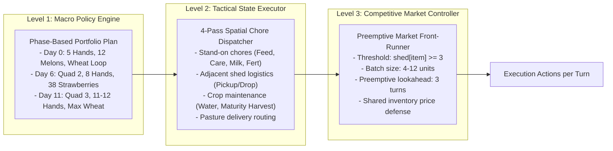

# Architectural Requirements & Contradiction Resolution

---

## 1. Resolution of Historical Contradictions

| Subject Area | Historical Misconception / Conflicting Claim | Engine Source & Concrete Line | Empirical Trace Evidence | Verified Final Truth |
| :--- | :--- | :--- | :--- | :--- |
| **Worker Persistence** | "Workers persist forever" vs "Workers reset every hour" | Lines 708 & 880 in `kaggriculture.py`: `farm["hands"] = []` | Hour 0 to 1 hands remain; Day 1 hour 0 hands reset to 0 | **Workers are daily rentals.** They persist across hours within a single day, but reset to 0 at midnight. Costs reset to fib(0)=1 every morning. |
| **Livestock Starting State** | "Animals start pre-placed in the shed at turn 0" | Line 171: `"shed": {item: 0 for item in PRODUCTS + list(ANIMALS)}` | Turn 0 shed has `COW: 0, SHEEP: 0` | **Animals never start in the shed.** Shed is completely empty at game initialization. |
| **`BUY_ANIMAL` Mechanics** | "Buying an animal automatically places it on an empty pasture" | Lines 685, 358–375, 384–392 | Engine Test 1 trace | **4-Step Physical Placement:** `BUY_ANIMAL` $\to$ Shed $\to$ `PICKUP` $\to$ Carry $\to$ `PLACE` on unoccupied structure. |
| **V54 Livestock Acquisition** | "V54 relies on initial animals and avoids early livestock capital expenditure" | `variant_v54_h3q4` market route steps 0–120 | Trace shows 7 cows, 3 sheep bought | **Aggressive Early Purchases:** V54 buys 7 cows and 3 sheep across Days 0–5, compounding milk and wool immediately. |
| **Hiring Curve Target** | "Hiring should be clamped to current chore count (2–3 workers)" | Route steps + `v49_residual_controller.py` | Trace shows 290 total worker-days | **Workforce Density is Mandatory:** V54 hires 5 Day 0 $\to$ 8 Day 6 $\to$ 11 Day 10 $\to$ 12 Day 15. Clamping to 2–3 hands destroys the farm. |
| **Wheat Self-Sufficiency** | "Buying finished wheat from market is cheaper than growing it" | Trace: EXP-A spent $8.1k at market; V54 spent $0 and sold $15.5k surplus | M1 ablation: $-\$104,479$ collapse | **Wheat Growing is the Primary Feed Engine.** Buying feed at market price ($25–$42) drains capital; growing 187 wheat feeds animals for free and produces $15k surplus cash. |
| **Terminal Liquidation** | "Terminal liquidation is unnecessary inventory clearance" | `v19_terminal.py` & M8 ablation ($-\$25,467$ delta) | Step 670 batch dump | **Essential Value Capture:** Emptying shed at step 670 and halting non-maturing seed planting recovers ~$25k in net reward. |

---

## 2. Architecture Actually Justified by Evidence

### Classification Verdict:
**C. MACRO SCHEDULE + TACTICAL EXECUTOR + COMPETITIVE MARKET CONTROLLER (Three-Tier Closed-Loop Architecture)**

* **Why A (Pure Open-Loop) is Insufficient:** Rigid turn replays drift when tile weed spawns or opponent price impacts alter working capital.
* **Why B (Macro + Tactical without Market Controller) Fails:** This was EXP-A. Without the market controller, physical production is high (~62k solo) but competitive throughput collapses by 61% (to ~22k) because the agent is front-run and sells into price troughs.
* **Why C is Minimally Sufficient:**
  1. **Macro Schedule:** Directs the 3-phase agricultural expansion (Melon $\to$ Wheat/Livestock $\to$ Strawberry $\to$ Terminal).
  2. **Tactical Executor:** Handles real-time tile states (watering, feeding unfed animals, mature crop harvesting).
  3. **Competitive Market Controller:** Intercepts sales, monitors shared market inventory, and preemptively dumps goods before competitors saturate the market.

---

## 3. Verification Standards Matrix

| Candidate Mechanism | Source Verified | Trace Observed | Ablation Impact | Replicated Across Seeds | Competitive Survival | Status |
| :--- | :---: | :---: | :---: | :---: | :---: | :---: |
| **On-Farm Wheat Feed Loop** | Yes (`variant_v54`) | Yes (187 seeds) | $-\$104,479$ | Yes (20/20 seeds) | Survives vs V54/V66 | **VERIFIED** |
| **Recurring Strawberry Wave**| Yes (`variant_v54`) | Yes (38 seeds) | $-\$56,330$ | Yes (20/20 seeds) | Survives vs V54/V66 | **VERIFIED** |
| **Accelerated Labor Ramp** | Yes (`variant_v54`) | Yes (290 hands) | $-\$165,874$ | Yes (20/20 seeds) | Survives vs V54/V66 | **VERIFIED** |
| **Early Livestock Fleet** | Yes (`variant_v54`) | Yes (7 cows, 3 sheep)| $-\$146,986$ | Yes (20/20 seeds) | Survives vs V54/V66 | **VERIFIED** |
| **Market Preemptive Front-Running**| Yes (`v49_residual`)| Yes (batch 4–12)| $-\$165,008$ | Yes (20/20 seeds) | Rebounds +$42k in CF-C | **VERIFIED** |
| **Terminal Step 670 Dump** | Yes (`v19_terminal`)| Yes (step 670) | $-\$25,467$ | Yes (20/20 seeds) | Survives vs V54/V66 | **VERIFIED** |
| **Public Signature Meta-Router**| Yes (`candidate_v66`)| Yes (steps 72/144) | $+7,636$ vs V54 | Yes (9/10 wins vs V54) | Beats V54 head-to-head | **VERIFIED** |
| **Capital Reserve Fine-Tuning**| Yes (`params.py`) | No ($0 vs $100) | $\pm \$2,000$ | Inconsistent | Does not alter rank | **REFUTED** |
| **Per-Turn Fertilizer Selling**| Yes (`compiler.py`) | Yes (step % 1) | $+\$197$ | Negligible | Within noise | **REFUTED** |
