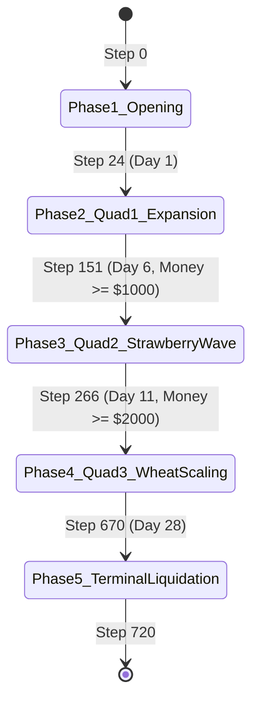

# Behavioral State Machine & Closed-Loop Attribution: V54 & V66

---

## 1. Tactical State Inputs & Exact Triggers

V54/V66 decisions are governed by a hybrid architecture combining an offline proposal schedule with real-time state-dependent triggers.

### State Input Vectors
* `step` $\in [0, 719]$, `day = step // 24`, `hour = step % 24`
* `money`: Current liquid cash on farm
* `unlocked_quadrants`: Number of owned quads ($1, 2, 3$)
* `shed[item]`: Product count in shed ($item \in \{\text{MILK}, \text{WOOL}, \text{FERT}, \text{WHEAT}, \text{STRAW}, \text{MELON}\}$)
* `seeds[crop]`: Unplanted seeds in bag
* `tiles[y][x]`: Grid state (structure kind, animal hunger, watering status, crop age)
* `market["inventory"][item]`, `market["prices"][item]`
* `opponent_public`: Money, hands, visible asset counts, visible shop instances

---

## 2. Explicit State Transition & Trigger Rules

### Rule S1: Opening Labor Burst
* **Trigger:** `IF hour == 0 AND day == 0 THEN HIRE 5`
* **Condition:** `money >= _hire_cost(hires_today)`
* **Action:** Orders `[["HIRE"]] * 5` sequentially on Step 0.
* **Exact Threshold:** Requires $12 liquid cash out of starting $150.

### Rule S2: Land Expansion 1 (Quadrant 2)
* **Trigger:** `IF day >= 6 AND len(unlocked_quads) == 1 AND money >= 1000 THEN BUY_LAND`
* **Action:** Submits `["BUY_LAND"]` at step 151. Unlocks NE quadrant.

### Rule S3: Land Expansion 2 (Quadrant 3)
* **Trigger:** `IF day >= 11 AND len(unlocked_quads) == 2 AND money >= 2000 THEN BUY_LAND`
* **Action:** Submits `["BUY_LAND"]` at step 266. Unlocks SW quadrant.

### Rule S4: Strawberry Wave Activation
* **Trigger:** `IF step >= 128 AND day <= 12 AND seeds_bought["STRAWBERRY"] < 38 AND money >= 100 THEN BUY_SEED("STRAWBERRY", batch)`
* **Action:** Buys 38 strawberry seeds across steps 128–288, planting immediately on Quad 2/3 tiles.

### Rule S5: Wheat Feed & Cash Rotation
* **Trigger:** `IF (day < 6 AND wheat_planted < 30) OR (day >= 6 AND empty_tiles > 0 AND strawberry_seeds == 0) THEN BUY_SEED("WHEAT", batch)`
* **Action:** Continuously cycles wheat seeds; harvests replenish shed wheat; animals fed when `tile["fed_today"] == False`.

### Rule S6: Market Preemptive Front-Running (`_V51ResidualConfig`)
* **Trigger:**  
  $$\text{IF } \text{shed}[item] \ge \text{front\_supply\_threshold } (3.0) \text{ AND } \text{preempt\_enabled } (\text{True}) \text{ AND } \text{step} < 670$$
* **Action:** Submits `["SELL", item, min(shed[item], preempt_max_batch)]` (batch size = 4 units per order, up to 3 orders = 12 units).
* **Exact Code Location:** `forensic_verification/extracted_sources/v49_modules/v49_residual_controller.py` lines 42–180.

### Rule S7: Terminal Liquidation
* **Trigger:** `IF step >= 670 THEN SELL_ALL`
* **Action:** Unloads every sellable unit in shed at maximum order batch size (30 units per order). Stops watering crops that cannot mature before turn 720.

---

## 3. Open-Loop vs Closed-Loop Attribution Table

| Strategic Mechanism | Type | State Variables | Exact Trigger / Threshold | Action Generated | Executable Source Evidence |
| :--- | :---: | :--- | :--- | :--- | :--- |
| **Opening Labor Burst** | **OPEN_LOOP** | `step == 0`, `money >= 12` | Step 0 | Hire 5 workers | `variant_v54_h3q4/main.py` route step 0 |
| **Mid-Game Labor Scaling** | **HYBRID** | `day`, `unlocked_quads`, `money` | Day 6 (8 hands), Day 10 (11 hands), Day 15 (12 hands) | Daily hire orders at hour 0 | Route actions + `v49_residual_controller.py` |
| **Quadrant Expansion** | **STATE_TRIGGERED** | `money >= cost`, `day >= target` | Step 151 ($1k), Step 266 ($2k) | `BUY_LAND` | Route actions at step 151 and 266 |
| **Melon Crop Wave** | **OPEN_LOOP** | `day <= 1`, `money >= 80` | Steps 0, 1, 24 | Buy 12 melon seeds | Route steps 0, 1, 24 |
| **Early Wheat Production**| **STATE_TRIGGERED** | `empty_tiles`, `shed["WHEAT"]` | Day 0–5, unplanted tiles | Buy & plant 187 wheat seeds | Route actions + weed repair fallback |
| **Strawberry Wave** | **OPEN_LOOP** | `step >= 128`, `quads >= 2` | Steps 128–288 | Buy & plant 38 strawberry seeds | Route steps 128–288 |
| **Feed Maintenance** | **STATE_TRIGGERED** | `tile["fed_today"] == False`, `inv["WHEAT"]` | Daily morning chore loop | Unit moves to animal, executes `FEED` | Engine lines 505–514 |
| **Animal Care / Fertilizer**| **STATE_TRIGGERED** | `fertilizer_available == True` | Daily chore scan | `COLLECT_FERTILIZER`, `CARE` | Engine lines 515–530 |
| **Market Preemptive Sells** | **MARKET_TRIGGERED** | `shed[item] >= 3`, `preempt_horizon = 3` | Inventory available + upcoming price decay | `SELL` batch size 4–12 | `v49_residual_controller.py` lines 88–145 |
| **Opponent Signature Switch**| **OPPONENT_TRIGGERED**| `_public_signature(obs)` | Step 72 & Step 144 signature match | Switch route to 1 of 6 counter-policies | `candidate_v66_meta_closed_loop.py` lines 79–310 |
| **Terminal Clearance** | **OPEN_LOOP** | `step >= 670` | Step 670 | Max batch sell, halt planting | `v19_terminal.py` |
