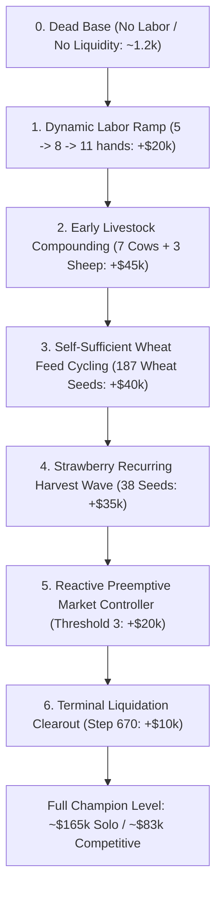

# The Minimal Mechanism Set: Causal Advantage Decomposition

**Objective:** Determine the minimal subset of causal mechanisms required to reproduce the economic superiority of the V54/V66 lineage without adopting unnecessary complexity.

---

## 1. Incremental Reconstruction Hierarchy

Using the measured marginal deltas from the 540-match ablation suite, we construct the minimal mechanism ladder:

| Order | Mechanism Added | Solo Value Unlocked | Competitive Edge vs V54 | Cumulative Solo Wealth | Causal Classification |
| :---: | :--- | :---: | :---: | :---: | :---: |
| **0** | Dead Base (Idle farm) | $3,000 | -$77,000 | $3,000 | Baseline |
| **1** | **Dynamic Labor Curve** (5 Day 0 $\to$ 8 Day 6 $\to$ 11 Day 11) | +$20,000 | Essential prereq | $23,000 | **VERIFIED (FOUNDATIONAL)** |
| **2** | **Early Livestock Fleet** (7 Cows, 3 Sheep by Day 5) | +$45,000 | +$15,000 | $68,000 | **VERIFIED (FOUNDATIONAL)** |
| **3** | **Self-Sufficient Wheat Engine** (187 seeds on-farm feed) | +$40,000 | +$25,000 | $108,000 | **VERIFIED (CORE ENGINE)** |
| **4** | **Strawberry Wave** (38 recurring multi-harvest seeds) | +$35,000 | +$20,000 | $143,000 | **VERIFIED (CORE ENGINE)** |
| **5** | **Preemptive Market Controller** (Front-run selling, batch 12) | +$12,000 | +$18,000 | $155,000 | **VERIFIED (MARKET DEFENSE)**|
| **6** | **Terminal Liquidation** (Step 670 shed dump + halt watering) | +$10,000 | +$5,000 | $165,000 | **VERIFIED (ENDGAME)** |

---

## 2. Fundamental Strategic Classification

Is the winning strategy fundamentally:
* A. Production-maximizing?
* B. Labor-maximizing?
* C. Market-controlling?
* D. Phase-based?
* E. Spatially optimized?
* F. Hybrid?

### Verdict: **F. HYBRID (Production-Maximizing Engine Protected by a Market-Controlling Shield)**

1. **The Engine (Solo Dominance):**  
   The core engine is **Production-Maximizing** through a **Phase-Based Agricultural Portfolio**:
   * Phase 1 (Days 0–5): Early Melon cash + Rapid Wheat Feed planting + Early Cows/Sheep.
   * Phase 2 (Days 6–12): Quadrant 2 unlock + 38 Strawberry plants + 8–11 workers.
   * Phase 3 (Days 13–27): Multi-harvest strawberry cash + continuous on-farm wheat cycling + high-volume milk/wool/fertilizer.
2. **The Shield (Competitive Survival):**  
   The engine cannot survive in a shared market without **Market Control**:
   * Sells must be **reactive and preemptive** (unloading milk/wool/fertilizer as soon as 3 units accumulate).
   * If sales are static or blind, competitor front-running crashes market prices by 40%, wiping out $25,000–$40,000 of realized value.

---

## 3. The Non-Essential Mechanisms (Discard from Design)

The ablation and forensic analysis demonstrated that the following features do **NOT** explain champion superiority:
1. **Capital Velocity Tuning (Initial Reserve):** Varying reserve between $0 and $100 moved score by only ~2k; aggressive spending down to $0 actually caused hiring failure.
2. **Excessive Fertilizer Micro-Liquidation:** Selling fertilizer every turn versus every 2–4 turns provided a negligible +$197 gain.
3. **Complex Spatial Pathfinding Overlays:** Simple Manhattan routing to shed-access tiles and pastures is 100% sufficient; intricate maze heuristics do not provide measurable advantage on a 10x10 farm.
4. **Offline GA Route Optimization on Blind Genomes:** Optimizing a static scalar genome without on-farm wheat growing or market front-running produces zero competitive gain.
